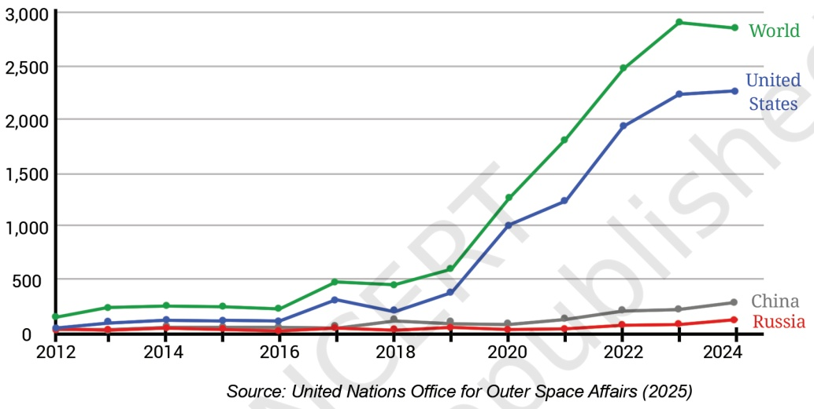

• What would a plot of the monthly minimum temperatures for these states look like?

What thoughts or questions occur to you?

## Space Jam: A Traffic Problem in the Future?

Take a look at the line graph below showing the annual number of objects launched into space.

Annual number of objects launched into space Including satellites, probes, landers, crewed spacecrafts, and space station flight elements launched into Earth orbit or beyond.

## ？ What could be the possible method used to derive this data? Discuss.

## Step 1: Identify what is given

Notice how the graph is organised, what scale is used, and what patterns the data shows.

## Step 2: Infer from and interpret what is given

7 Analyse and interpret each of the observations you made. Once all interpretations are made, summarising/concluding statements can be made.

In 2024, the worldwide count is around 2800, whereas in 2023, it was around 2900. We can say that 2023 saw the highest number of objects launched into space worldwide (assuming the trend before 2012 was decreasing).

The counts of the three countries don’t add up to the worldwide count. Therefore, we can infer that the counts of other countries are not shown in this visualisation.