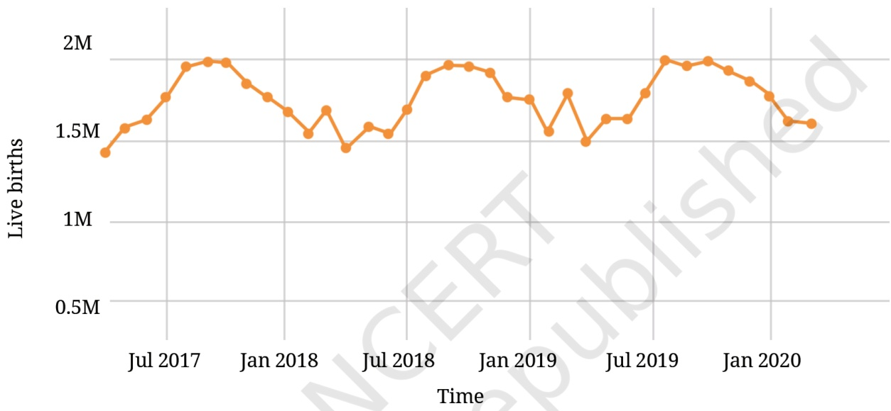

(iii) Based on the line for New Delhi in the graph fill the data in the table.

(iv) Which city among these receives the most number of days of rainfall per year? Which city gets the least number of days of rainfall per year?

(v) Looking at the table, when is the rainy season in New Delhi and Rameswaram?

2. The following line graph shows the number of births in every month in India over a time period:

Source: Nambiar et al (Forthcoming) –“Seasonal variations in births in India'

(i) What are your observations?

(ii) What was the approximate number of births in July 2017?

(iii) What time period does the graph capture?

(iv) Compare the number of births in the month of January in the years 2018, 2019, and 2020.

(v) Estimate the number of births in the year 2019.

## Infographics

In Grade 6, we saw an example of how infographics can be used to communicate information and insights more clearly and quickly in a visually appealing way. Take a look at the following infographic. Are you able to understand the information presented here?