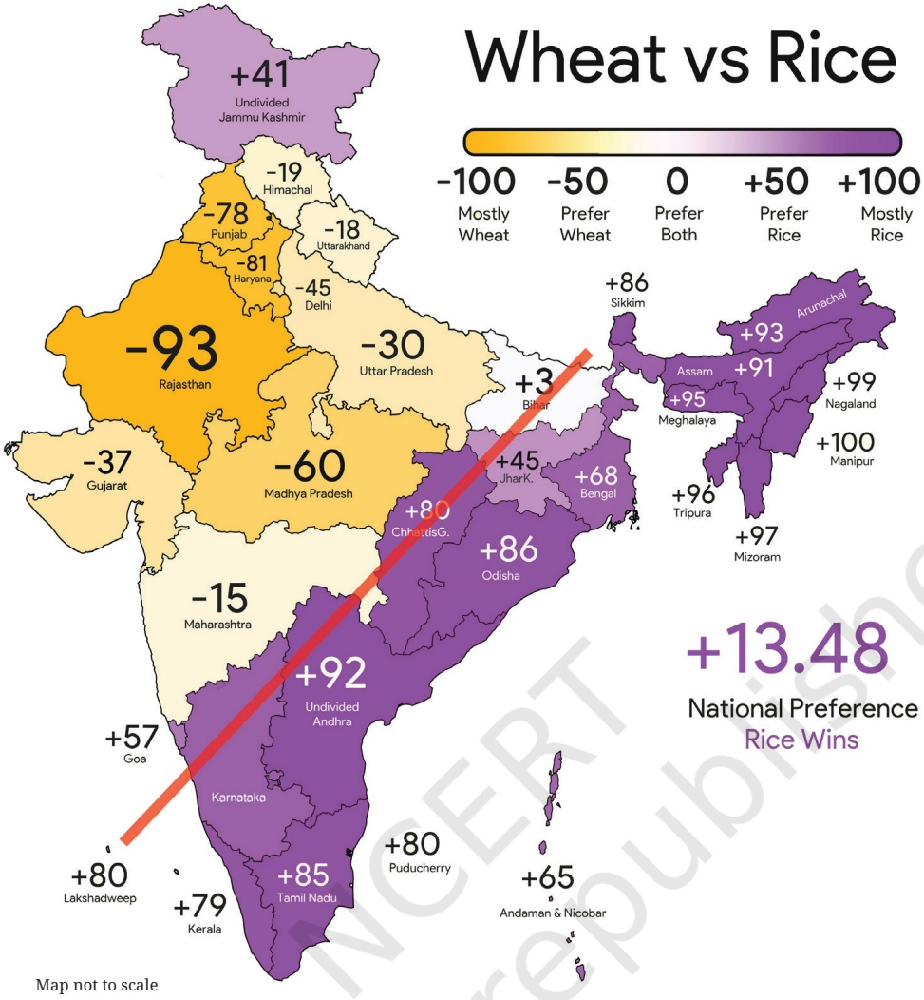

Source: 68th National Sample Survey June 2014, data from 2011–12, created using iipmaps.com

This infographic compares the preference between rice and wheat in different states. The colour scale at the top right indicates how to interpret the different shades in terms of preferences.

The difference between the per capita consumption of rice and wheat is mapped to values between – 100 and + 100. A value of + 100 doesn’t mean that the state doesn’t consume wheat at all. It means that this state prefers mostly rice and the difference between per capita rice and wheat consumption is the highest. Isn’t it interesting how there is a clear geographical split in preferences of rice vs. wheat shown by the red line?

Share your observations. Based on this infographic, answer the following:

(i) The value of Karnataka is hidden. Can you guess what it could be?

(ii) Which are the top 5 states where rice is the most popular?

(iii) Which are the top 5 states where wheat is the most popular?

(iv) List a few states where the preference between rice and wheat is more or less balanced.