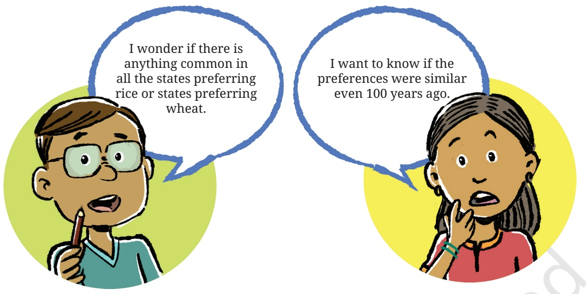
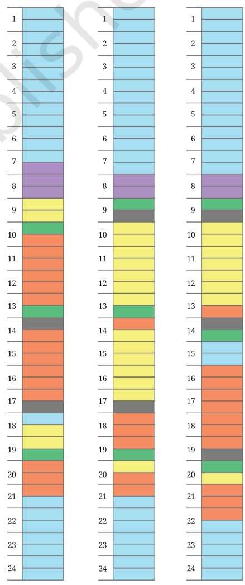

I wonder if there is anything common in all the states preferring rice or states preferring wheat.

I want to know if the preferences were similar even 100 years ago.

## What can a Strip Say?

Manoj has an interesting hobby. He makes note of what he does throughout the day. He records his activities by colouring a strip of paper with 48 boxes, marking time in 30 minute intervals from midnight to midnight.

He has recorded five types of activities for three different days of the week on three coloured strips, shown to the right.

(i) Sleeping

(ii) Eating

(iii) Meeting friends, hobbies, media, time with family

(iv) Attending classes, studying and homework

(v) Showering and getting dressed, yoga or exercise

(vi) Travelling

Look at the three coloured strips carefully.

(i) What activity does each colour stand for?

(ii) The three strips correspond to the days Friday – Sunday in some order. Which day do you think each strip represents?

(iii) On one of these days, he went out with friends to watch a long movie. When do you think this happened?

(iv) At what time does his school break for lunch?

(v) What more can the strips tell us?