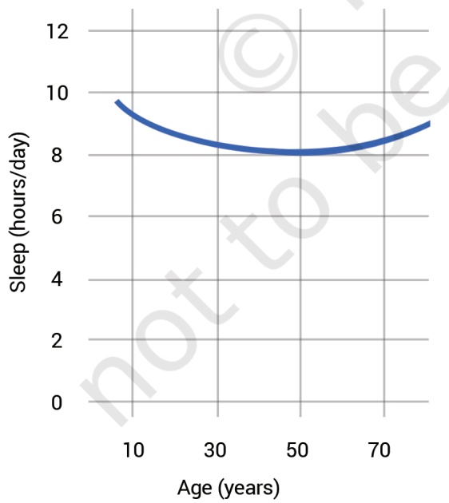
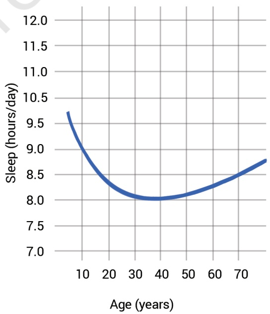

？ What would your strip for a weekday look like? How similar or different is it to Manoj’s?

? What would a strip of your typical day during your vacation look like? How similar/different would it look?

What would a strip for any of the adults in your family look like? Make a strip of a day for any adult at home. Compare your strip with theirs. What do you find interesting?

## Data Story: Sleepy-Deepy

Do you remember the sleep time pie chart from the Proportionality chapter?

Isn’t it amusing that there are animals that sleep as little as 2 hours per day and animals that sleep as much as 20 hours per day? How about insects — have you seen any insect sleep/rest? Humans typically sleep for about 7 –  9 hours a day. The sleep duration can vary greatly among people. The amount of sleep people need depends on age, living conditions, lifestyle (food they consume, the activities they engage in, etc.) among other factors. You may have observed that babies sleep longer than adults.

The line graphs below show typical sleep durations of Indians across ages 6 to 75. The second picture is a zoomed-in version of the first picture.

Night sleep across ages

Night sleep across ages

Source: National Time Use Survey 2024