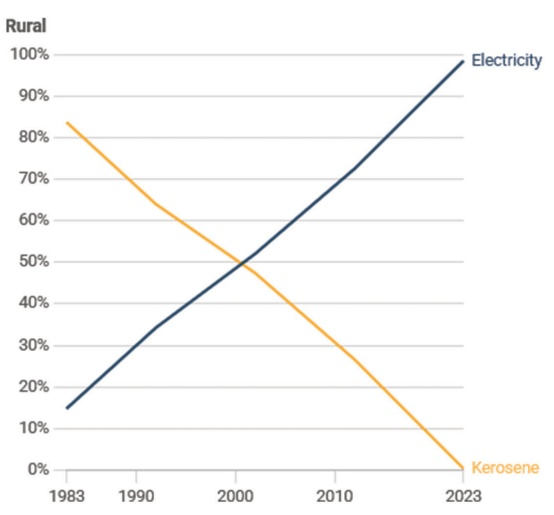
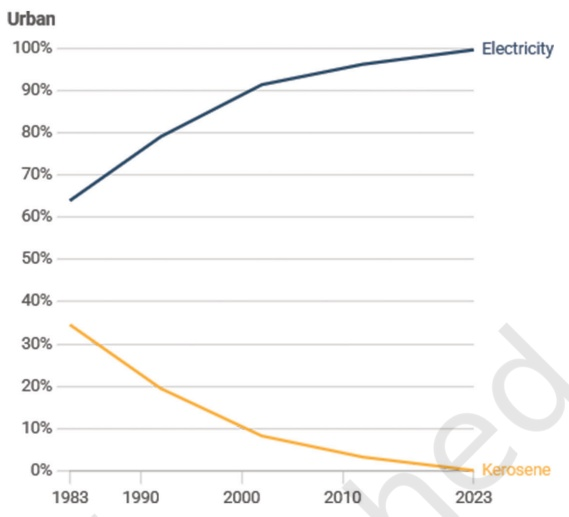
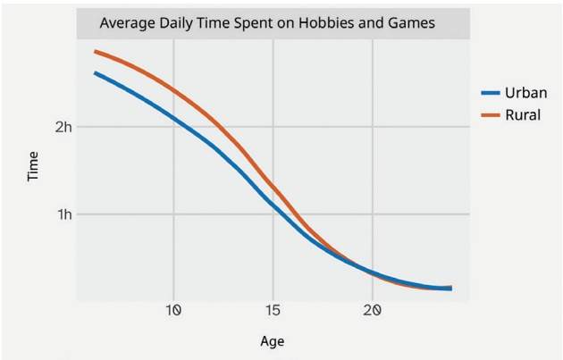

10. Referring to the graph below, which of the following statements are valid? Why?

## Primary source of energy for household lighting over time

Numbers represent share of households by primary source of energy used for lighting

Source: Household Consumer Expenditure Survey (HCES), various years, by National Sample Survey Office (NSSO)

Data ForIndia

(i) In 1983, the majority in rural areas used kerosene as a primary lighting source while the majority in urban areas used electricity.

(ii) The use of kerosene as a primary lighting source has decreased over time in both rural and urban areas.

(iii) In the year 2000, 10% of the urban households used electricity as a primary lighting source.

(iv) In 2023, there were no power cuts.

11. Answer the following questions based on the line graph.

(i) How long do children aged 10 in urban areas spend each day on hobbies and games?

(ii) At what age is the average time spent daily on hobbies and games

by rural kids 1.5 hours?

(a) 8 years

(b) 10 years

(c) 12 years

(d) 14 years

(e) 18 years

