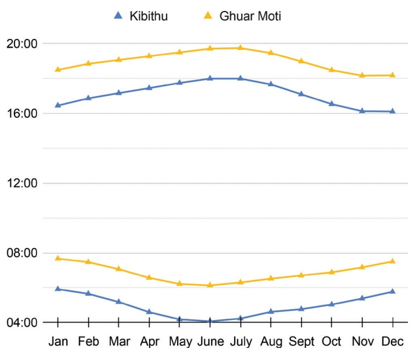
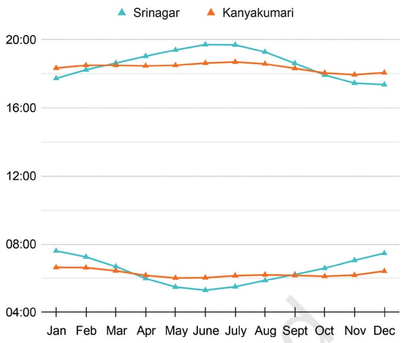
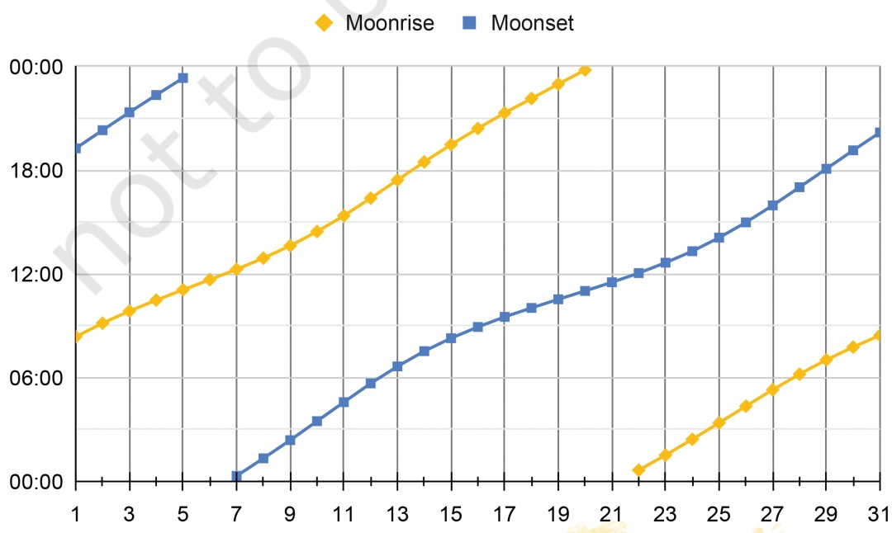

Answer the following questions based on the graphs:

(i) At which place does the sun rise the earliest in January? What is the approximate day length at this place in January?

(ii) Which place has the longest day length over the year?

(iii) Share your observations — what do you find interesting? What are you curious to find out?

15. We all know the typical sunrise and sunset timings. Do you know when the moon rises and sets? Does it follow a regular pattern like the sun? Let’s find out. The following graph shows the moonrise and moonset time over a month:

(i) Find out on what dates amavasya (new moon) and purnima (full moon) were in this month.

(ii) What do you notice? What do you wonder?

