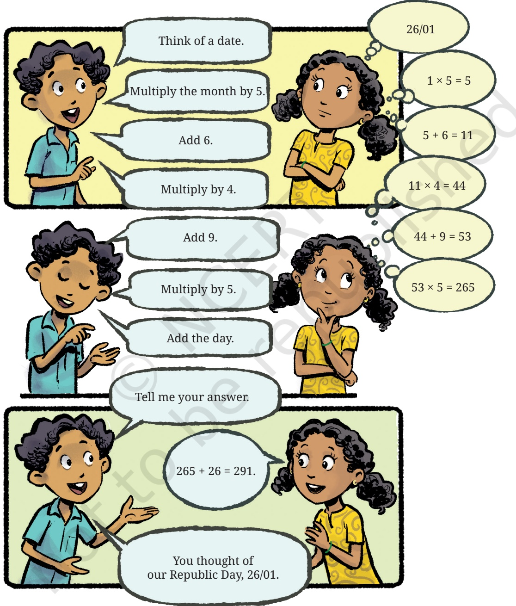

## ？ How would you change this game to make the final answer 3? What about 5?

## ？ Can you come up with more complicated steps that always lead to the same final value?

Let us now look at a different trick of this type.

？ How did Shubham figure out the date chosen by Mukta?

• Let the month be M and the day be D.

• Multiply M by 5: 5M