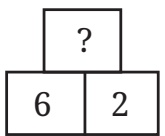
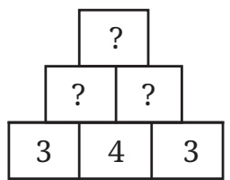
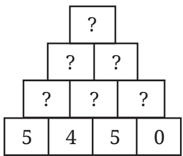
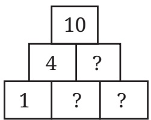
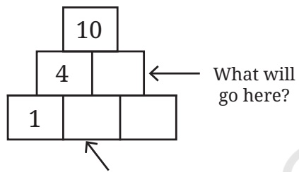
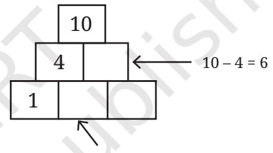
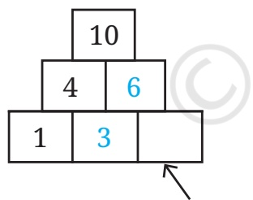
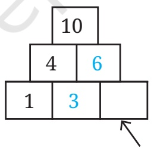
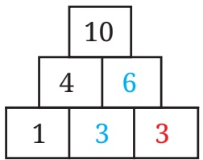
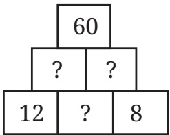

？ Use the same rule to fill these pyramids:

？ How do we fill this pyramid?

And here?

What will go here?

4 – 1 = 3

What will go here?

6 – 3 = 3

What about filling in the numbers in this pyramid? Where do we start?

