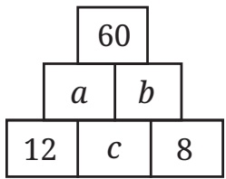
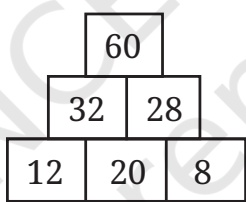
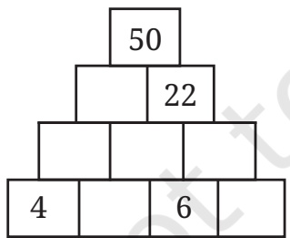
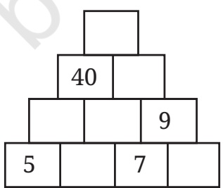
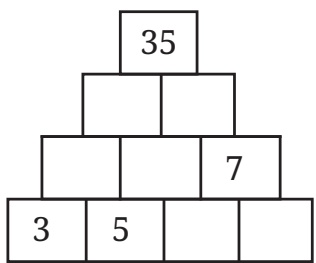
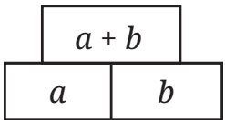

Let us fill the empty boxes with letter-numbers.

From the rules for filling up pyramids, we get the following equations.

$a + b = 60$

$12 + c = a$

$c + 8 = b$

From this, we see that,

$(12 + c) + (c + 8) = a + b = 60$

Hence,

$20 + 2c = 60$

$2c = 60 - 20 = 40$

$c = 2 0 .$

Once we know c, we can find a and b, and complete the pyramid.

？ Fill the following pyramids:

？ What is the relationship between the numbers in the bottom row and the number at the top?

Let us start with the simplest pyramid.

