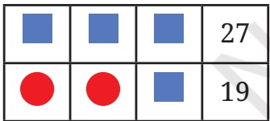
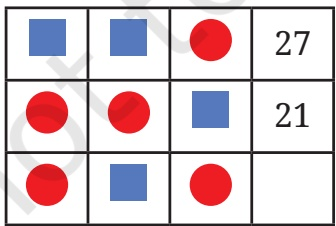
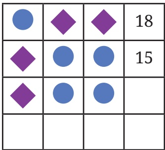

<table><tbody><tr><td colspan="7">AUGUST 2025</td></tr><tr><td>SUN</td><td>MON</td><td>TUE</td><td>WED</td><td>THU</td><td>FRI</td><td>SAT</td></tr><tr><td></td><td></td><td></td><td></td><td></td><td>1</td><td>2</td></tr><tr><td>3</td><td>4</td><td>5</td><td>6</td><td>7</td><td>8</td><td>9</td></tr><tr><td>10</td><td>11</td><td>12</td><td>13</td><td>14</td><td>15</td><td>16</td></tr><tr><td rowspan="2">17</td><td rowspan="2">18</td><td rowspan="2">19</td><td rowspan="2">20</td><td rowspan="2">21</td><td></td><td rowspan="2">23</td></tr><tr><td>22</td></tr><tr><td>24</td><td>25</td><td>26</td><td>27</td><td>28</td><td>29</td><td>30</td></tr><tr><td>31</td><td></td><td></td><td></td><td></td><td></td><td></td></tr></tbody></table>

<table><tbody><tr><td rowspan="2">2</td><td rowspan="2">3</td><td rowspan="2">4</td><td rowspan="2">5</td><td rowspan="2">6</td><td rowspan="2">7</td><td>8</td><td>9</td><td rowspan="2">10</td></tr><tr><td></td><td></td></tr><tr><td>12</td><td>13</td><td>14</td><td>15</td><td>16</td><td>17</td><td>18</td><td>19</td><td>20</td></tr><tr><td rowspan="2">22</td><td rowspan="2">23</td><td rowspan="2">24</td><td rowspan="2">25</td><td rowspan="2">26</td><td></td><td rowspan="2">28</td><td rowspan="2">29</td><td rowspan="2">30</td></tr><tr><td>27</td></tr><tr><td>32</td><td>33</td><td>34</td><td>35</td><td>36</td><td>37</td><td>38</td><td>39</td><td>40</td></tr><tr><td>42</td><td>43</td><td>44</td><td>45</td><td>46</td><td>47</td><td>48</td><td>49</td><td>50</td></tr></tbody></table>

## Algebra Grids

In the following grid, shapes represent numbers. In each row, the last column is the sum of the values to its left. How do we find the values of the shapes?

=So, 9

Now, + + = 19

\+ + =9 19

2 × + =9 19

= 5

## ？ In the following grids, find the values of the shapes and fill in the empty squares:

## 6.5 The Largest Product

Fill the digits 2, 3, and 5 in × using each digit once. What is the largest product possible?