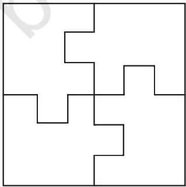

## 7.1 Rectangle and Squares

## ？ How many different ways can you divide a square into 4 parts of equal area?

One can actually think of infinitely many such ways! Consider a division, such as

and alter each part as follows.

In each part, the area is compressed along one edge and expanded along another edge. If both the compression and expansion are of the same magnitude, then all 4 parts still have the same area!

Try to think of different creative ways to divide a square into 4 parts of equal area.