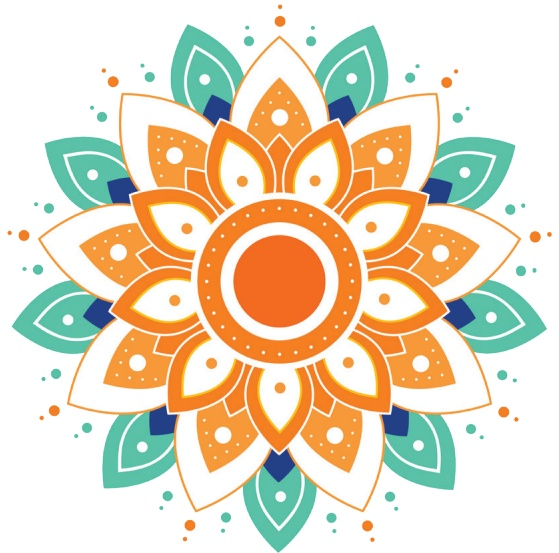
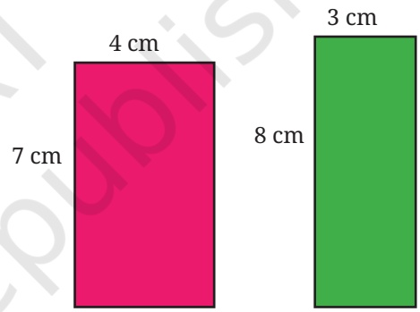

You might have seen the rangoli art form, in which regions of different shapes are beautifully coloured using rangoli powder.

？ Which of these rectangles requires more rangoli powder to be coloured, if the colouring is done evenly?

We can answer this by counting the number of non-overlapping unit squares (squares of sidelength 1 cm in this case) that can be packed into each of the rectangles.

Clearly, the rectangle having sidelengths 7 cm and 4 cm contains 7 × 4 = 28 unit squares, and the rectangle having sidelengths 8 cm and 3 cm contains 8 × 3 = 24 unit squares.

Thus, the rectangle of sidelengths 7 cm and 4 cm requires more powder to be coloured.

Recall that we measure the area of a region by finding the number of unit squares (which can also be a fraction) whose area equals that of the given region.

We have seen that the number of unit squares contained in a rectangle is given by the product of its length and width —

$$
A r e a \; o f a \; r e c t a n g l e = l e n g t h \times w i d t h .
$$

The areas of the rectangles as seen in the previous problem are generally written as 28 sq. cm and 24 sq. cm, or as 28 cm2 and 24 cm2.