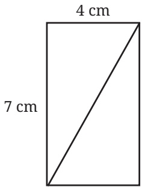
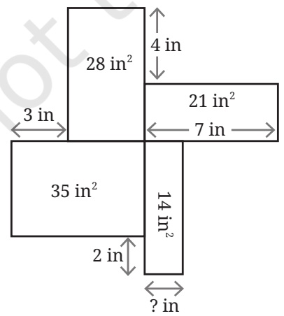
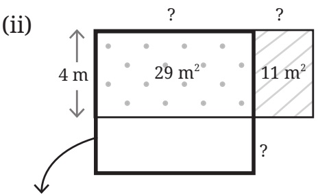

## ？ What is the area of each triangle in this rectangle?

We have seen that the diagonal of a rectangle divides it into two congruent triangles. So, the area of each triangle is half the area of the rectangle.

In terms of unit squares, half the area fills exactly half the number of unit squares.

So the area of each triangle is $\frac{1}{2} \times 7 \times 4 = 14  cm ^2.$

## Why Can’t Perimeter be a Measure of Area?

？ Why do we count the number of unit squares to assign measures for area? Couldn’t we have just used the perimeter of a region, i.e., the length of its boundary as a measure of its area?

? If two regions have the same perimeter, can’t we conclude that they have the same area? Or, if one region has a larger perimeter than another region, can’t we conclude that it also has a larger area?

The perimeter of a region is not indicative of its area. The reason is that regions can have the same perimeter but different areas, and vice versa. We can even find two regions, Region 1 and Region 2, such that

Perimeter of Region 1 > Perimeter of Region 2, but Area of Region 1 < Area of Region 2.

？ Find two rectangles that are examples of such regions. If needed, use a grid paper (given at the end of the book) for this.

Also give an example of two regions of other shapes, where the region with the larger perimeter has the smaller area! This property should be visually clear in your example.

## Figure it Out

1. Identify the missing sidelengths.

(i)

Area = 50 m2