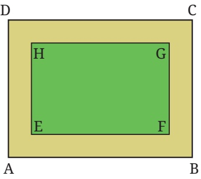
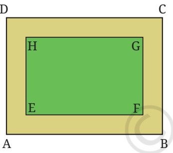
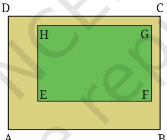
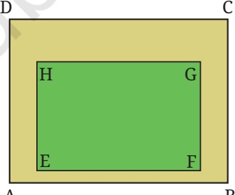

D

2. The figure shows a path (the shaded portion) laid around a rectangular park EFGH.

(i) What measurements do you need to find the area of the path? Once you identify the lengths to be measured, assign possible values of your choice to these measurements and find the area of the path. Give a formula for the area.

An example of a formula — Area of a rectangle = length × width. [**Hint:** There is a relation between the areas of EFGH, the path, and ABCD.]

(ii) If the width of the path along each side is given, can you find its area? If not, what other measurements do you need? Assign values of your choice to these measurements and find the area of the path. Give a formula for the area using these measurements. [**Hint:** Break the path into rectangles.]

(iii) Does the area of the path change when the outer rectangle is moved while keeping the inner rectangular park EFGH inside it, as shown?

B

3. The figure shows a plot with sides 14m and 12m, and with a crosspath. What other measurements do you need to find the area of the crosspath? Once you identify the lengths to be measured, assign some possible values of your choice and find the area of the path. Give a formula for the area based on the measurements you choose.

