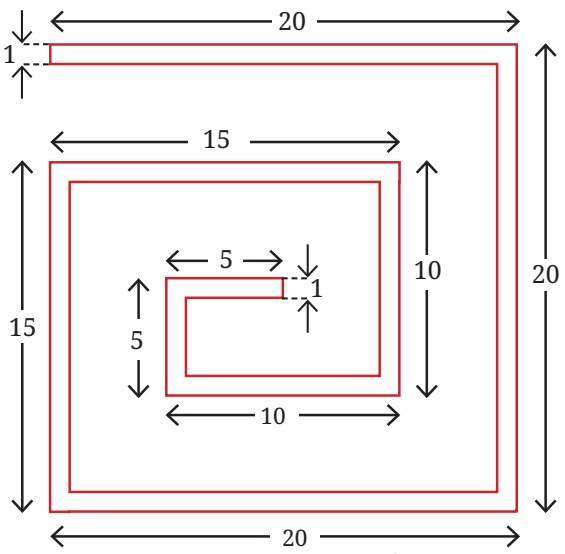
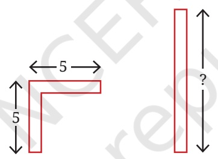
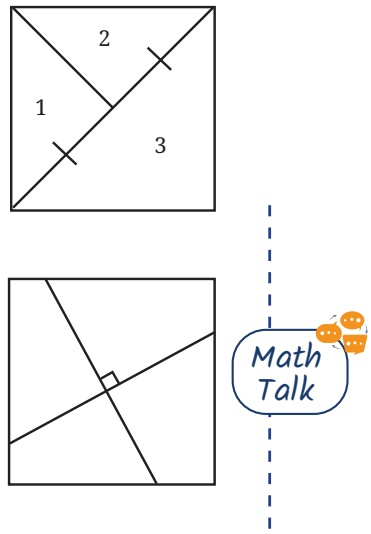

4. Find the area of the spiral tube shown in the figure. The tube has the same width throughout.

[**Hint:** There are different ways of finding the area. Here is one method.]

What should be the length of the straight tube if it is to have the same area as the bent tube on the left?

5. In this figure, if the sidelength of the square is doubled, what is the increase in the areas of the regions 1, 2 and 3? Give reasons.

6. Divide a square into 4 parts by drawing two perpendicular lines inside the square as shown in the figure.

Rearrange the pieces to get a larger square, with a hole inside.

You can try this activity by constructing the square using cardboard, thick chart paper, or similar materials.

