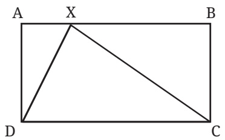
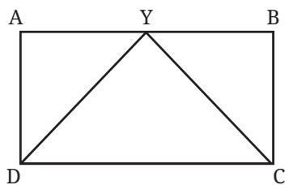
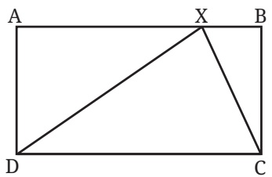
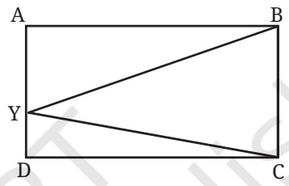
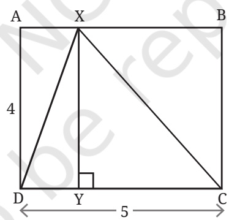
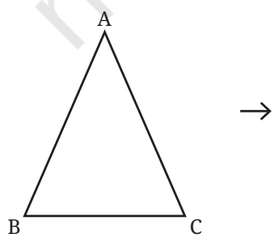
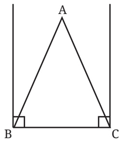
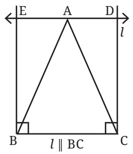

## Triangles

？ In the given figure, which triangle has a greater area: ∆XDC or ∆YDC, if both the rectangles are identical?

？ In the given figure, which triangle has a greater area: ∆XDC or ∆YBC, if both the rectangles are identical?

In each case, by dropping the altitudes from X and Y, it becomes clear that each triangle has exactly half the area of the rectangle ABCD.

## ？ Find the area of $\Delta \mathrm { X D C } ,$

Fig. 7.1

？ To find the area of a triangle, what measurements do we need? We need the sidelengths of the outer rectangle, as in Fig. 7.1.

How do we get the outer rectangle from the given triangle?

153