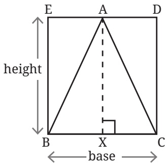
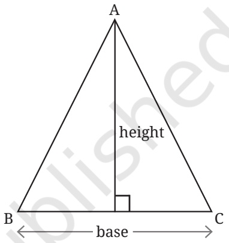
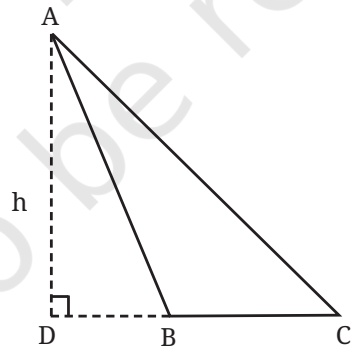

BCDE is a rectangle (how?). Let us take its sidelengths to be height and base. Then,

$$
A r e a ( \triangle A B C ) = \frac { 1 } { 2 } \times b a s e \times h e i g h t
$$

Since BXAE is a rectangle (how?), the height of the rectangle is the same as the height of the triangle.

Thus, if the height and the base of a triangle are known, we can find its area.

Area of a triangle $= { \frac { 1 } { 2 } } \times$ base × height.

？ Will this formula hold for the kind of triangle, around which we cannot draw a rectangle with BC as the base?

Here is one way to look at it. The area of $\Delta \mathrm { A B C }$ is the difference of the areas of ∆ADC and ∆ADB, each of which can be enclosed in a rectangle, as in Fig. 7.1.

$$
{ \begin{aligned} { { \mathrm { A r e a } } \; ( \Delta { \mathrm { A B C } } ) } & { { } = { \frac { 1 } { 2 } } \times h \times { \mathrm { D C } } - { \frac { 1 } { 2 } } \times h \times { \mathrm { D B } } } \\ { } & { { } = { \frac { 1 } { 2 } } \times h \; ( { \mathrm { D C } } - { \mathrm { D B } } ) } \\ { } & { { } = { \frac { 1 } { 2 } } \times h \times { \mathrm { B C } } } \end{aligned} }
$$

Thus, the area formula holds for all types of triangles.