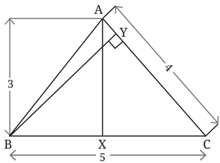
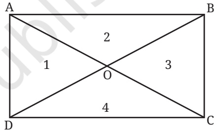
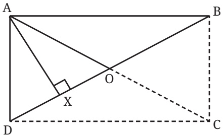
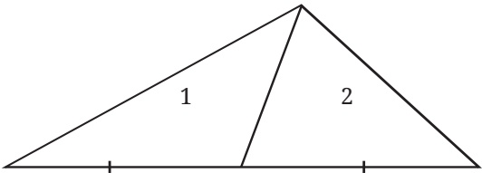

## Some Applications of the Area Formula

## Find BY.

BY can be found using the formula for the area of a triangle.

What is Area (∆ABC)?

Area $( \Delta  ABC  ) = \frac{1}{2} \times  AX  \times  BC  = \frac{15}{2}$ sq. units.

The area of the triangle can also be written as

$$
\mathrm{Area}\left(\Delta \mathrm{ABC}\right)=\frac{1}{2} \times \mathrm{BY} \times \mathrm{AC}=\frac{1}{2} \times 4 \times \mathrm{BY}=2 \mathrm{BY}
$$

Thus,

$$
2 \; \mathrm { B Y } = { \frac { 1 5 } { 2 } } .
$$

$$
\mathrm{SO}, \mathrm{BY} = \frac{15}{4} = 3.75 \mathrm{units}.
$$

Are the 4 triangles obtained by drawing the diagonals of a rectangle

(regions 1 – 4 in the figure) of equal areas?

Clearly, the triangles 1 – 4 are not four congruent triangles.

To compare their areas, let us consider any two adjacent triangles, say 1 and 2.

Since the area of a triangle depends on its height and the base, let us consider suitable height-base pairs in each of the triangles. If OD and OB are taken as the bases, then we see that both triangles have the same altitude!

We also have $\mathrm{OB} = \mathrm{OD},$ since the diagonals of

a rectangle bisect each other. So, the triangles 1 and 2 have equal areas.

Arguing this way, we can show that all four triangles have equal areas.

From this problem, we can make the following general statement.

In a triangle, the line joining a vertex to the midpoint of its opposite side divides the triangle into two triangles of equal areas.

Triangles 1 and 2 have equal areas as they have the same measures for height and base