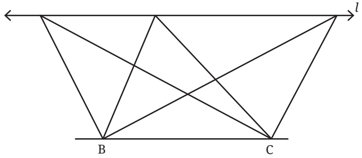
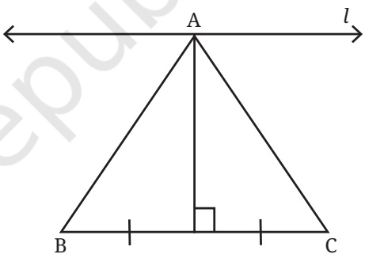

**Triangles between Parallel Lines with a Common Base**

？ Line l‖BC. Consider the different triangles that have BC as their base, and with their third vertex lying anywhere on l.

(i) Which of these triangles has the maximum area, and which has the minimum area?

(ii) Which of these triangles has the maximum perimeter, and which has the minimum perimeter?

Here, we will only show how to find the triangle with the minimum perimeter, and leave the other questions as exercises.

Intuition might suggest that the triangle with the minimum perimeter can be obtained by constructing the perpendicular bisector of BC.

But how do we justify that this triangle has the least perimeter among all the triangles?

Firstly, note that in all these triangles, BC is a common side. Therefore, it is enough to consider the sum of the other two sides.

Let us imagine the line l as a mirror. Then we get a reflection of all the points and lines below it.

While studying the properties of a plane mirror, we experimentally observed that the distance of the image behind the mirror is the same as the distance of the object (that creates the image) in front of the mirror. This law can be used to locate the reflections of the points lying below the line l.