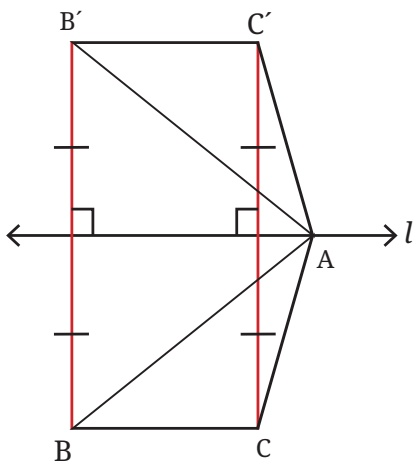
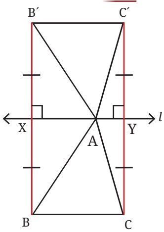
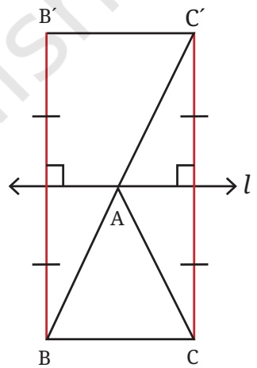
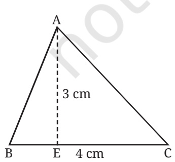
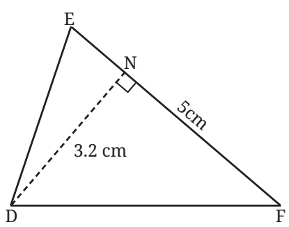
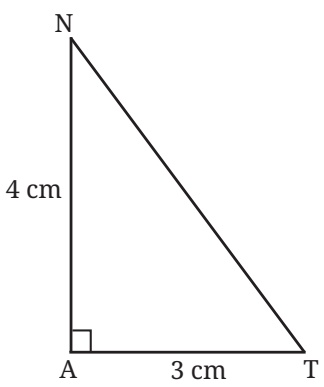

What can we say about the lengths of AB and its reflection $\mathrm { A B ^ { \prime } } ?$

Since $\Delta \mathrm{AXB} \cong \Delta \mathrm{AXB}', \Delta \mathrm{B} = \mathrm{AB}'$

Similarly, $\mathrm{AC} = \mathrm{AC}'$

Therefore, the length of the path $\mathrm { B } \to \mathrm { A } \to \mathrm { C }$ is the same as the length of the path $\overline { { \mathsf { B } } }   \xrightarrow { }   \mathsf { A }   \xrightarrow { }   \mathsf { C } ^ { \prime }$

This is true no matter where point A is on line l.

So, finding point A that gives the shortest possible path $\mathrm { B \rightarrow } \mathrm { A \rightarrow } \mathrm { C }$ is the same as finding a point A that gives the shortest possible path $\mathrm{B} \to \mathrm{A} \to \mathrm{C}$

But the solution to the latter problem is clear — choose A on the straight line $$\mathrm { B } \mathbb { C } \mathrm {  勺  } ,$$ since $\mathrm { ~ B C ~ } _ { 1 } ^ { \prime }$ is the shortest possible path from B to $\mathsf { C } ^ { \prime }$

Therefore, this triangle ∆ABC has the minimum perimeter.

？ Analyse whether A lies on the perpendicular bisector of BC.

## Figure it Out

1. Find the areas of the following triangles:

(i)

(ii)

(iii)