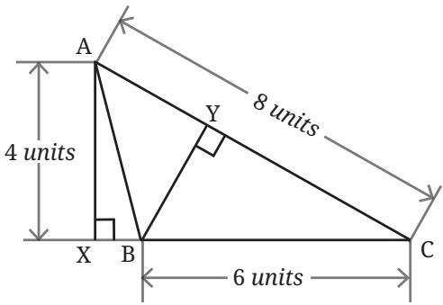
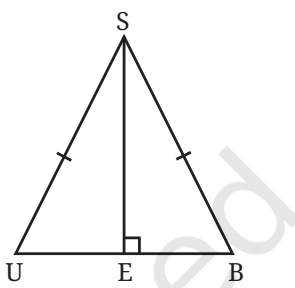
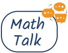
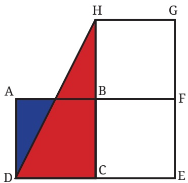

## 2. Find the length of the altitude BY.

3. Find the area of ∆SUB, given that it is isosceles, SE is perpendicular to UB, and the area of ∆SEB is 24 sq. units.

In the Śulba-Sūtras, which are ancient Indian geometric texts that deal with the construction of altars, we can find many interesting problems on the topic of areas. When altars are built, they must have the exact prescribed shape and area. This gives rise to problems of the kind where one has to transform a given shape into another of the same area. The Śulba-Sūtras give solutions to many such problems.

Such problems are also posed and solved in Euclid’s Elements. Here are two problems of this kind.

4. [Śulba-Sūtras] Give a method to transform a rectangle into a triangle of equal area.

5. [Śulba-Sūtras] Give a method to transform a triangle into a rectangle of equal area.

6. ABCD, BCEF, and BFGH are identical squares.

(i) If the area of the red region is 49 sq. units, then what is the area of the blue region?

(ii) In another version of this figure, if the total area enclosed by the blue and red regions is 180 sq. units, then what is the area of each square?

