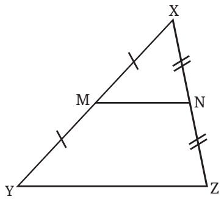
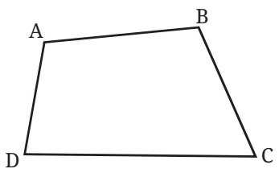

7. If M and N are the midpoints of XY and XZ, what fraction of the area of ∆XYZ is the area of ∆XMN? [**Hint:** Join NY]

8. Gopal needs to carry water from the river to his water tank. He starts from his house. What is the shortest path he can take from his house to the river and then to the water tank? Roughly recreate the map in your notebook and trace the shortest path.

## River

## Water tank

## House

## Area of any Polygon

？ How do we find the area of this quadrilateral? What measurements do we need for this?

If we join BD, the quadrilateral ABCD gets divided into two triangles. By finding their areas, we can find the area of ABCD.

？ How do we find the area of this pentagon?

？ Can any polygon be divided into triangles?

It can be seen that any polygon can be divided into triangles. Thus, by knowing how to compute the area of a triangle, we can find the area of any polygon.