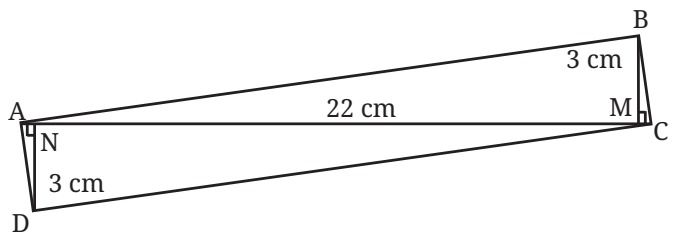
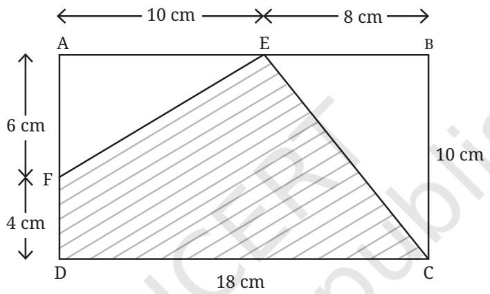
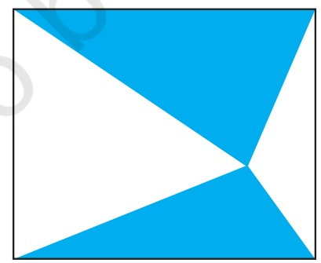

## Figure it Out

1. Find the area of the quadrilateral ABCD given that AC = 22 cm, BM = 3 cm, DN = 3 cm, BM is perpendicular to AC, and DN is perpendicular to AC.

2. Find the area of the shaded region given that ABCD is a rectangle.

3. What measurements would you need to find the area of a regular hexagon?

Math Talk

4. What fraction of the total area of the rectangle is the area of the blue region?

Math Talk

5. Give a method to obtain a quadrilateral whose area is half that of a given quadrilateral.

One can derive special formulae to find the areas of a parallelogram, rhombus and trapezium.