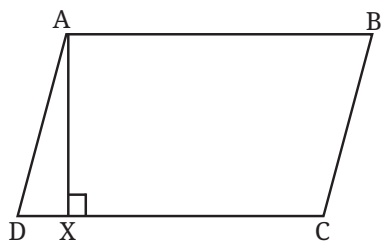
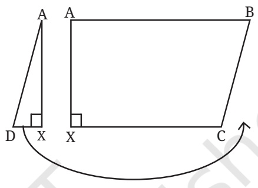
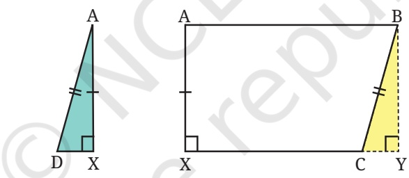

## Parallelogram

We can derive a special formula for the area of a parallelogram by converting it into a rectangle of equal area.

？ Give a method to convert a parallelogram into a rectangle of equal area. You can try this using a cut-out of a parallelogram.

Construct AX perpendicular to CD — represented in short as $AX  \perp  CD$ We call this a **height** of the parallelogram. Cut the parallelogram into ∆AXD and trapezium ABCX.

? Can ∆AXD and ABCX fit together, as shown in the figure, to get a rectangle?

One simple way to check this is to identify the triangle that can complete ABCX to a rectangle, and then check if this triangle is congruent to ∆AXD.

Observe that $\angle X = 90^{\circ}$ , and so $\angle A = 90^{\circ}$ , since AB‖XC. We need another right angle to get a rectangle (what about the fourth angle?). To get the third right angle, extend XC to the right and then construct a line perpendicular to XC that passes through B. The ∆BYC completes ABCX to a rectangle. Is ∆AXD congruent to it?

BY = AX (since ABYX is a rectangle)

$$
\angle BTC = \angle AAD = 90^{\circ}
$$

$$
\mathrm{BC} = \mathrm{AD} (  since ABCD is a parallellogram  )
$$

So, by the RHS congruency criterion, $\Delta \mathrm{BYC} \cong \Delta \mathrm{AXD}$ . Thus, ∆AXD will fit exactly over the region occupied by ∆BYC, and convert the parallelogram into a rectangle.

The process of cutting a figure into pieces and rearranging them to get a different figure of equal area is called **dissection.**