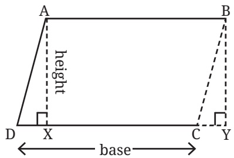
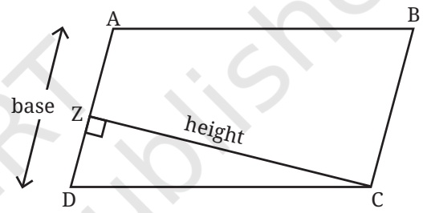
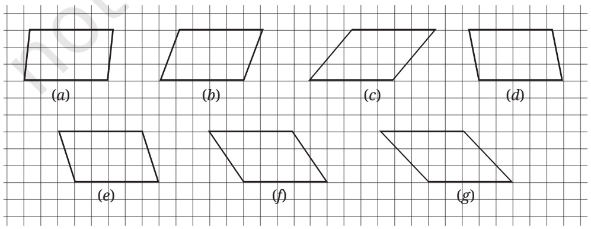

？ How do we find the area of a parallelogram by dissecting it into a rectangle? We have

Area of the parallelogram ABCD = Area of the rectangle ABYX.

Area of the rectangle ABYX = AX × XY. AX is the height of the parallelogram.

Is there a relation between XY and DC?

Since DX = CY, we get DC = XY by adding the common part XC to DX and CY. Since DC is the base of the parallelogram, we get

Area of the parallelogram = base × height.

Can the area of the parallelogram be determined by taking another side as the base and its corresponding height?

? Can the parallelogram be cut along CZ and rearranged to form a rectangle?

It can be seen that this is indeed possible, and so any side and its corresponding height can be used to find the area of a parallelogram.

## Figure it Out

1. Observe the parallelograms in the figure below.

(i) What can we say about the areas of all these parallelograms?

(ii) What can we say about their perimeters? Which figure appears to have the maximum perimeter, and which has the minimum perimeter?

