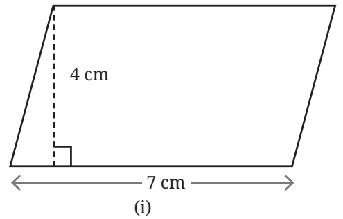
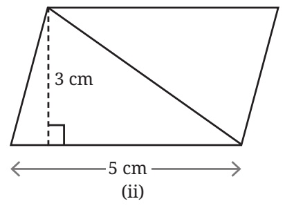
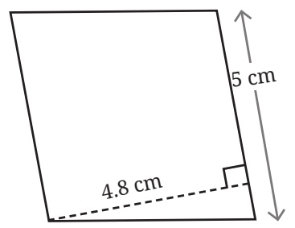
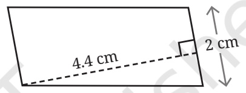
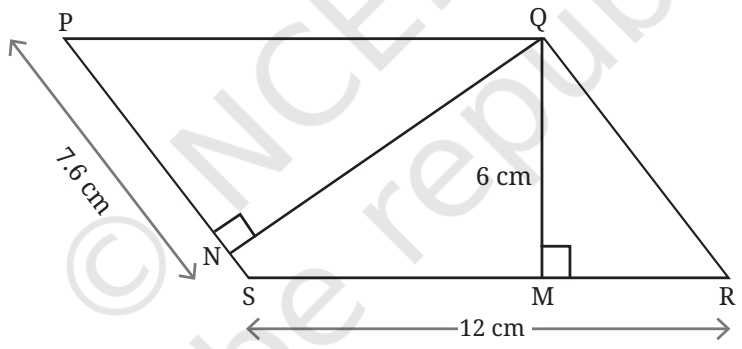
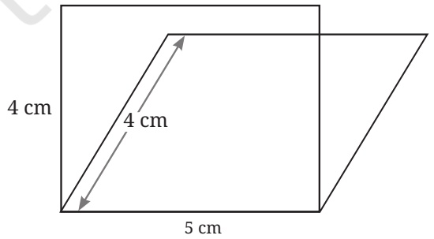

2. Find the areas of the following parallelograms:

(iii)

(iv)

3. Find QN.

4. Consider a rectangle and a parallelogram of the same sidelengths: 5 cm and 4 cm. Which has the greater area? [**Hint:** Imagine constructing them on the same base.]

5. Give a method to obtain a rectangle whose area is twice that of a given triangle. What are the different methods that you can think of?