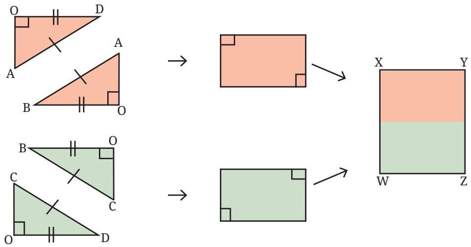
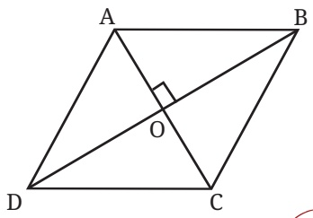

Since ABCD is a rhombus, all its sides have equal length, and the diagonals are perpendicular bisectors of each other. Therefore, ∆ABD and ∆CBD are isosceles triangles. Each of them can be transformed into a rectangle of equal area, and the two rectangles can then be joined to form a single rectangle. This rectangle, say WXYZ, has the same area as the rhombus ABCD.

What are the sidelengths of the rectangle WXYZ?

From the dissection, we can see that

XW = length of the diagonal AC, and

WZ = half the length of the other diagonal BD.

Thus, we have

$$
\begin{aligned}\underset{\textcircled{C}}{\operatorname{Area}} \text { of} \underset{\text {hom}}{\operatorname{hom}} \underset{\text {is }}{\operatorname{ABCD}} & \overset{\rightharpoonup }{=} \underset{\text {A}}{\operatorname{free}} \text { of } \underset{\text {rectangle }}{\operatorname{WXYZ}} \\& = \underset{\text {XW}}{\operatorname{XW}} \times \underset{\text {WZ}}{\operatorname{WZ}} \\& = \underset{\text {AC}}{\operatorname{AC}} \times \frac{\mathrm{BD}}{2} \\& = \frac{1}{2} \times \underset{\text {AC}}{\operatorname{AC}} \times \mathrm{BD}\end{aligned}
$$

Therefore,

$$
\scriptstyle { \overline { { A r e a \; o f { \overline { { a } } } \; r h o m b u s } } } \; = \; { \frac { 1 } { 2 } } \; \times \; p r o d u c t \; o f d i a g o n a l s .
$$

？ Area of rhombus ABCD can also be determined by finding the areas of ∆ADB and ∆CDB. What formula does this give us?

Since the diagonals are perpendicular to each other, we have

$$
\mathrm{Area}(\Delta \mathrm{ADB})=\frac{1}{2} \times \mathrm{AO} \times \mathrm{BD}, \text { and }
$$

$$
\mathrm{Area}(\Delta \mathrm{CDB})=\frac{1}{2} \times \mathrm{CO} \times \mathrm{BD}, \mathrm{and}
$$

$$
\mathrm { A r e a ~ o f ~ r h o m b u s ~ A B C D } = \mathrm { A r e a } \left( \Delta \mathrm { A D B } \right) + \mathrm { A r e a } \left( \Delta \mathrm { C D B } \right) .\tag{165}
$$