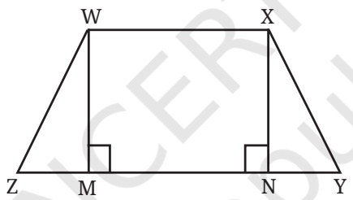
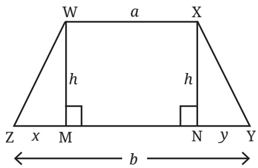

？ Simplify the expression to show that we get the same formula for the area of a rhombus in terms of its diagonals.

## Trapezium

? Find the areas of the following trapeziums by breaking them into figures whose areas can be computed.

<table><tr><td></td><td>A</td><td></td><td></td><td></td><td>B</td><td></td><td></td><td></td><td></td><td></td><td></td><td></td><td></td><td></td><td></td><td></td><td></td><td></td><td></td><td></td><td></td><td></td><td></td><td></td><td></td><td></td><td>W</td><td></td><td></td><td></td><td>X</td><td></td><td></td></tr><tr><td></td><td></td><td></td><td></td><td></td><td></td><td></td><td></td><td></td><td></td><td></td><td></td><td></td><td>P</td><td></td><td></td><td></td><td></td><td></td><td>Q</td><td></td><td></td><td></td><td></td><td></td><td></td><td>7</td><td></td><td></td><td></td><td></td><td></td><td></td><td></td></tr><tr><td></td><td></td><td></td><td></td><td></td><td>V</td><td></td><td></td><td></td><td></td><td></td><td></td><td></td><td></td><td></td><td></td><td></td><td></td><td></td><td></td><td></td><td></td><td></td><td></td><td></td><td></td><td>7</td><td></td><td></td><td></td><td></td><td></td><td>V</td><td></td></tr><tr><td></td><td></td><td></td><td></td><td></td><td></td><td></td><td></td><td></td><td></td><td></td><td></td><td>7</td><td></td><td></td><td></td><td></td><td></td><td></td><td></td><td></td><td></td><td></td><td></td><td></td><td></td><td></td><td></td><td></td><td></td><td></td><td></td><td></td><td></td></tr><tr><td></td><td></td><td></td><td></td><td></td><td></td><td>V</td><td></td><td></td><td></td><td></td><td>7</td><td></td><td></td><td></td><td></td><td></td><td></td><td></td><td></td><td>V</td><td></td><td></td><td></td><td></td><td>7</td><td></td><td></td><td></td><td></td><td></td><td></td><td></td><td>V</td></tr><tr><td colspan=2>D</td><td></td><td></td><td>M</td><td></td><td></td><td>C</td><td></td><td></td><td></td><td>S</td><td></td><td>T</td><td></td><td></td><td></td><td></td><td></td><td>U</td><td></td><td>R</td><td></td><td></td><td colspan=2>Z</td><td>M</td><td></td><td></td><td></td><td></td><td>N</td><td></td><td></td></tr><tr><td></td><td></td><td></td><td></td><td></td><td></td><td></td><td></td><td></td><td></td><td></td><td></td><td></td><td></td><td></td><td></td><td></td><td></td><td></td><td></td><td></td><td></td><td></td><td></td><td></td><td></td><td></td><td></td><td></td><td></td><td></td><td></td><td></td><td></td></tr></table>

rectangle and triangles.

？ Consider a trapezium WXYZ with WX ‖ ZY. Find its area.

Construct $\mathrm { W M } \perp \mathrm { Z Y }$ , and $\mathrm { X N } \perp \mathrm { Z Y }$ (WM and XN perpendicular to ZY).

Is WXNM a rectangle?

$\angle MWX = \angle NXW = 90^{\circ}$ , since WX‖ZY and the interior angles on the same side of a transversal (WM and XN) add up to 180°. Therefore, WXNM is a rectangle.

We have

$$
\mathrm{Area} \mathrm{WXYZ}=\mathrm{Area} (\Delta \mathrm{WZZ})+\mathrm{Area} \mathrm{WXNM}+\mathrm{Area} (\Delta \mathrm{XNM})
$$

Let us assign letter numbers to the lengths that we need to find the area of the trapezium. Let $\mathbf { M } \mathbf { Z } = \mathbf { \boldsymbol { x } } _ { \mathrm { { i } } }$ , WM = XN = h, WX = a, NY = y. So we get W a X

$$
{ \begin{array} { r l } { \operatorname { A r e a } \operatorname { W X Y Z } } & { = { \frac { 1 } { 2 } }   h x + h a + { \frac { 1 } { 2 } }   h y } \\ & { = h ( { \frac { 1 } { 2 } }   x + a + { \frac { 1 } { 2 } } y ) } \\ & { = h ( { \frac { x + y + 2 a } { 2 } } ) } \\ & { = { \frac { 1 } { 2 } }   h ( x + y + 2 a ) . } \end{array} }
$$

