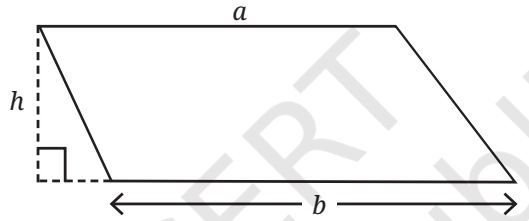
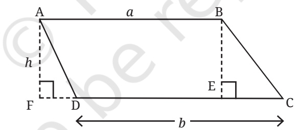
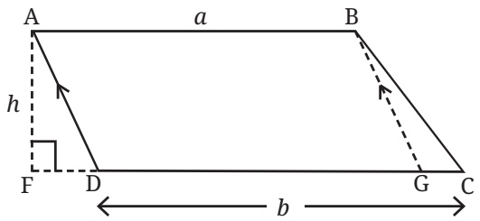

We have taken the length of one of the parallel sides as a. Let b be the length of the other parallel side.

Can the area of the trapezium be expressed in terms of a, b and h? To replace $x + y$ in the area expression with a and b, observe that $b = x + y + a.$ . Subtracting a from both sides, we get

$$
x + y = b - a .
$$

Using this, we get

$$
{ \mathrm { A r e a ~ W X Y Z } } = { \frac { 1 } { 2 } }   h ( b - a + 2 a ) , \qquad { \mathrm { A r e a ~ W X Y Z } } = { \frac { 1 } { 2 } }   h ( b - a + 2 a ) .
$$

Therefore,

Area of a trapezium $\scriptstyle { \frac { 1 } { 2 } } \times h e i g h t \times s u m$ of the parallel sides.

？ Will this formula hold for a trapezium that looks like this?

There are different ways of approaching this, which are sketched below. Complete the arguments.

**Approach 1: Rectangle and Triangles**

Area ABCD = Area ABED + Area ∆BEC Area ABED = Area ABEF – Area ∆AFD

**Approach 2: Parallelogram and Triangle**

Draw BG ‖ AD

? Will Approach 2 work for any type of trapezium?