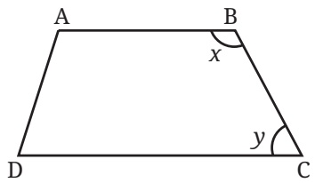
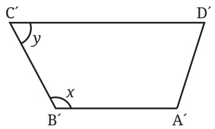
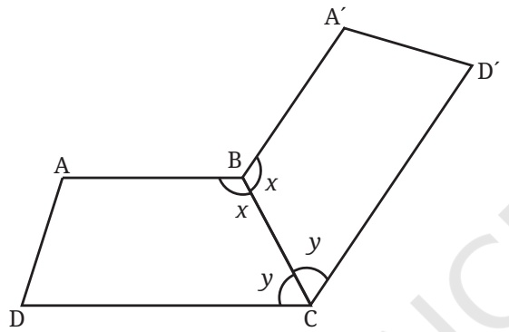
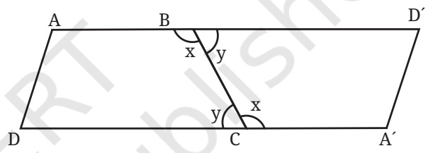
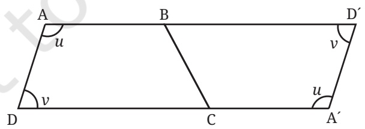
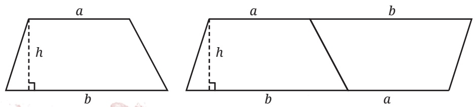

## Finding the Area Using Two Copies of the Trapezium

There is another interesting way of finding the area of a trapezium. Consider two copies of the given trapezium in which AB‖CD. Rotate the second copy as shown.

？ What figure will we get when the two trapeziums are joined along BC? The possibilities are either a 6-sided figure or a 4-sided figure (quadrilateral).

**Possibilities**

Quadrilateral

6-sided figure

We can rule out the first possibility by looking at the sum of angles x and y. Since AB ‖ CD, we have $x + y = 180$ , since they are internal angles along the same side of the transversal (BC). So ABD́ and A ́CD are straight lines. Therefore, the resulting figure is a quadrilateral.

What type of a quadrilateral is this?

Let us look at the other two angles of the trapezium.

We have $u + v = 180$ . Therefore, AD‖D́ A ́, since the sum of the internal angles along the same side of the transversal A ́D is 180°. Since we already have AD́  ‖ A ́D, the quadrilateral AD́ A ́D is actually a parallelogram.

168

