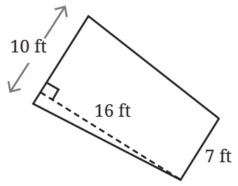
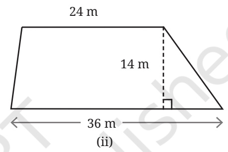
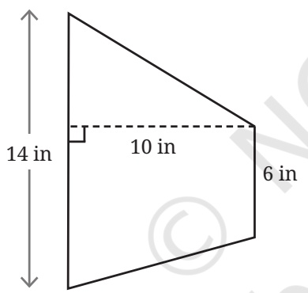
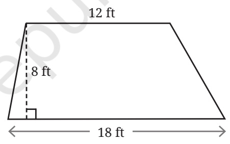
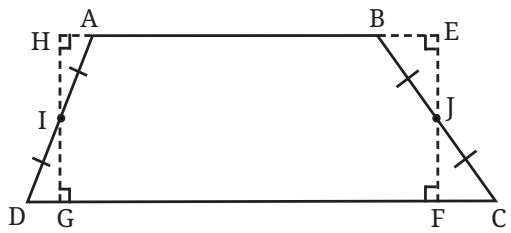

Area of the trapezium = $\models \frac { 1 } { 2 } \times A \tau$ rea of the parallelogram $\begin{array} { r } { = \frac { 1 } { 2 }   h ( a + b ) . } \end{array}$

## Figure it Out

1. Find the area of a rhombus whose diagonals are 20 cm and 15 cm.

2. Give a method to convert a rectangle into a rhombus of equal area using dissection.

3. Find the areas of the following figures:

(i)

(iii)

(iv)

4. [Śulba-Sūtras] Give a method to convert an isosceles trapezium to a rectangle using dissection.

5. Here is one of the ways to convert trapezium ABCD into a rectangle EFGH of equal area —

Given the trapezium ABCD, how do we find the vertices of the rectangle EFGH?

[**Hint:** If $\Delta \mathrm{AHI} \cong \Delta \mathrm{DGI}$ and $\Delta \mathrm{BE} \cong \Delta \mathrm{CF}$ , then the trapezium and rectangle have equal areas.]