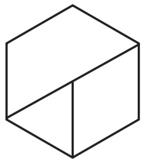
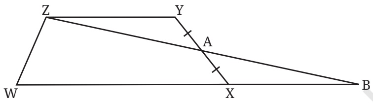
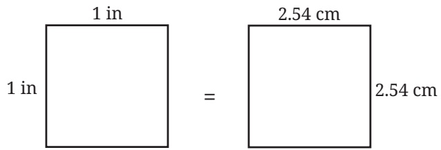

6. Using the idea of converting a trapezium into a rectangle of equal area, and vice versa, construct a trapezium of area 144 cm2.

7. A regular hexagon is divided into a trapezium, an equilateral triangle, and a rhombus, as shown. Find the ratio of their areas.

8. ZYXW is a trapezium with ZY‖WX. A is the midpoint of XY. Show that the area of the trapezium ZYXW is equal to the area of ∆ZWB.

## Areas in Real Life

What do you think is the area of an A4 sheet? Its sidelengths are 21 cm and 29.7 cm. Now find its area.

？ What do you think is the area of the tabletop that you use at school or at home? You could perhaps try to visualise how many A4 sheets can fit on your table.

The dimensions of furniture like tables and chairs are sometimes measured in inches (in) and feet (ft).

$$
\frac{1  in  \div 2.54  cm }{1  ft  = 12  in }
$$

? Express the following lengths in centimeters: (i) 5 in (ii) 7.4 in

？ Express the following lengths in inches: (i) 5.08 cm (ii) 11.43 cm

? How many cm2 is 1 $\mathrm { i n ^ { 2 } } ?$

So, 1 $\ln^{2}=2.54^{2}\  cm ^{2}=6.4516\  cm ^{2}$