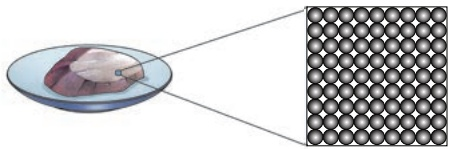
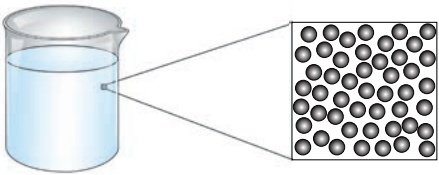
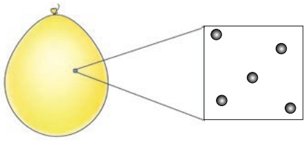
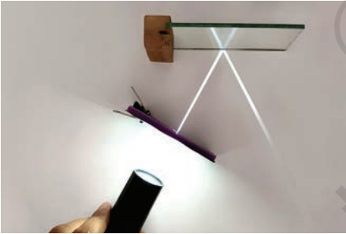

So, these forces are connected to powerful weather events—like storms and cyclones—that affect our daily lives, agriculture, and even our safety.

To truly understand how air can exert pressure or why water boils at a certain temperature we need to zoom into these materials and see what kind of particles they are made up of, and how they move around.

Everything around us is made of tiny particles. In materials that are solid these particles cannot move much, while in gases they can move around freely.

Classifying things around us is an important feature of science. We can also classify materials around us into elements (pure substances), compounds (two or more elements bonded together), and mixtures (combinations that can be separated physically).

Once we know how particles combine or mix, we can then understand solutions—for example, how sugar dissolves in tea to make it sweet.

From the world of particles and mixtures, we then move into the world of light. We’ll study how light rays reflect off flat and curved mirrors, and bends when passing through lenses and helps us understand the working of many objects around us. The bending of light explains what happens when we see an image in a shiny metal spoon or how corrective glasses help many of us see clearly.

It’s not just a polished mirror that reflects light, rough surfaces reflect light as well, and so does the Moon. Depending on the relative positions of the Earth, Moon and Sun, a slightly different part of the Moon is illuminated each night, giving rise to the beautiful phases of the Moon that we see in the sky.

Watching the periodic cycles of the Moon’s phases allowed humans to come up with the first calendars. By combining careful observations of sunrises, sunsets, and lunar cycles, various calendars came into being. Isn’t it fascinating that the calendars which determine our routines on Earth are linked to the motions of objects far beyond our planet?