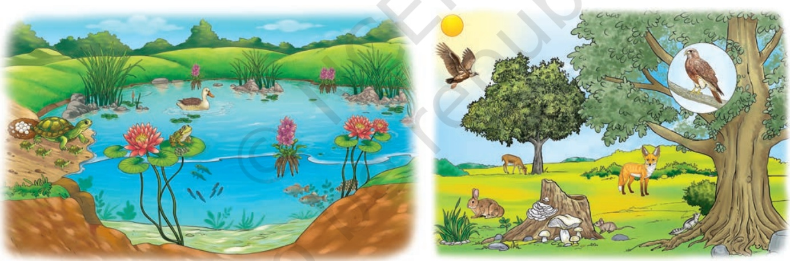

But it’s not just calendars or the movements of the Sun and Moon that are linked. Right here on Earth, there are marvellous and complex patterns of relationships between living organisms and their environments. Every living being — from tiniest insect to the largest whale, from blades of grasses to tall trees — depends on and responds to the air, water, sunlight, and other organisms around them forming the ecosystems that support life on our planet.

<table><tr><td colspan=7>SUN MON TUE WED THU FRI SAT</td></tr><tr><td colspan=7></td></tr><tr><td></td><td></td><td></td><td></td><td></td><td></td><td>122</td></tr><tr><td>223</td><td>324</td><td>425</td><td>526</td><td>6</td><td>72827</td><td>829</td></tr><tr><td>9 30</td><td>10</td><td>All31</td><td>122</td><td>133</td><td>14₄</td><td>155</td></tr><tr><td>166</td><td>178</td><td>187</td><td>1992</td><td>010</td><td>212</td><td>212</td></tr><tr><td>2313</td><td>2415</td><td>2514</td><td>2616</td><td>2717</td><td>2818</td><td>2919</td></tr><tr><td>302o</td><td></td><td></td><td></td><td></td><td></td><td></td></tr></table>

In the final chapter of this book, we can put it all together and try to understand what makes

Earth ‘just right’ for life and to recognise the urgent challenges that our planet now faces.

Most importantly, the Earth lies at the perfect distance from the Sun, where water remains liquid, and it has an atmosphere that provides the oxygen we breathe while shielding us from harmful ultraviolet rays. But human activities on the planet can cause small changes in the temperature of the Earth, disrupting climate patterns, with dangerous consequences.

At the heart of both the problem—and any possible solution — is us. We are the ones influencing Earth’s climate. But we are also the ones who can—and must—use science to understand these changes and guide our actions.

The same scientific principles that we have guided our journey through the middle stages—observing, measuring, experimenting—will be key in helping us protect the delicate balance on which life depends. The challenges ahead won’t always be easy. We hope some of you will try to solve these difficult problems with Curiosity as your guide.