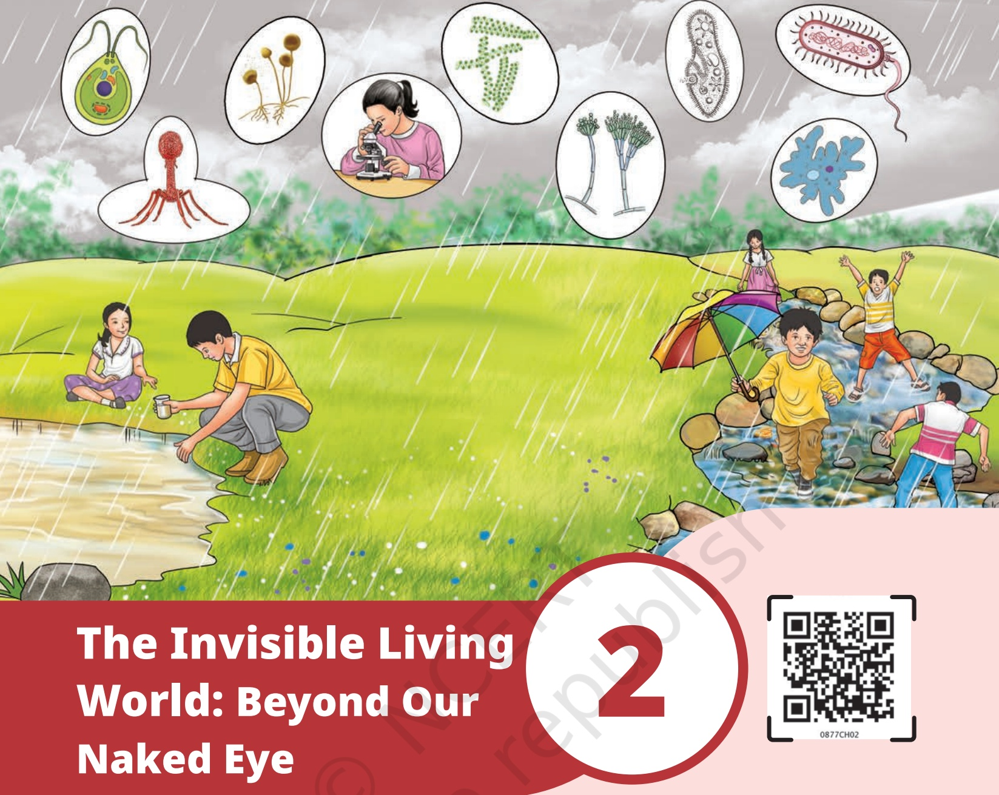

## The Invisible Living World: Beyond Our Naked Eye

z Have you ever wondered what you might see if the invisible world around you became visible?

z How do you think your observation of this hidden world might change the way you think about size, complexity, or even what counts as ‘living’?

z Have you thought how these tiny living beings interact with each other?

z Share your questions