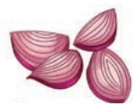
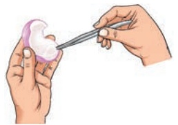
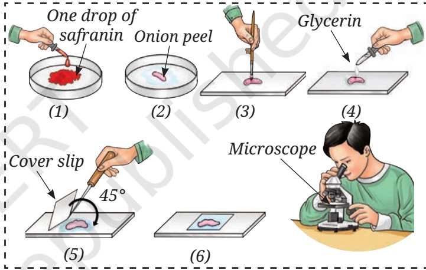
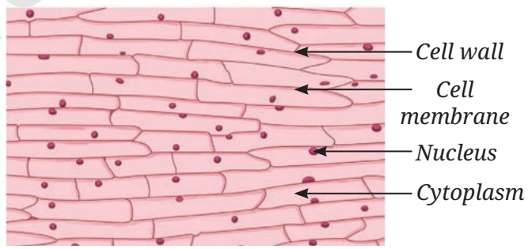
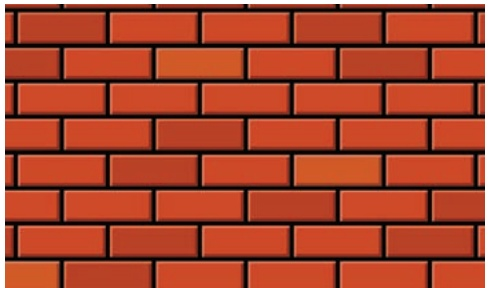

## Activity 2.2: Let us study a cell (Teacher demonstration activity)

z Take an onion bulb from your kitchen or garden and wash it thoroughly with water.

Cut the onion bulb vertically into pieces.

z Take one piece of onion and pull out the thin, transparent layer from its inner surface with the help of forceps. This layer is called the onion peel.

Fig. 2.3: (a) Removing onion peel from an onion bulb

z Place the peel in a petri dish containing a few drops of safranin (red-coloured stain) for 30 seconds. This will give a pinkish colour to the cells and help us see them clearly.

z With the help of thin brush transfer the onion peel to another

petri dish containing water to rinse the peel and remove extra stain.

z Now, carefully place the stained onion peel on the glass slide using a thin brush, ensuring it does not break or fold.

z Put a drop of glycerin over the onion peel on the slide. The glycerin will prevent drying of the cells and improve clarity for better visualisation of cells.

z Slowly place a coverslip over the peel using a needle, such that no air bubbles get trapped.

z Use blotting paper to gently wipe off any extra glycerin around the edges of the coverslip.

z Observe the slide under a microscope (A simple foldable paper microscope will suffice). **Compare** it with Fig. 2.3c.

z What similarities do you find in Fig. 2.3c and Fig. 2.3d?

You will observe nearly rectangular structures under the microscope. These are the cells of the onion peel, which are closely arranged without any space between them. Try to observe the peels of the leaves of different plants around you. You will find that all plants are made up of cells. What do you think the body of an animal is made of?

(b)

(c)

(d)

Fig. 2.3: (b) Mounting the onion peel in glycerin using a needle; (c) Structure of onion peel under the microscope; and (d) A wall made of brick