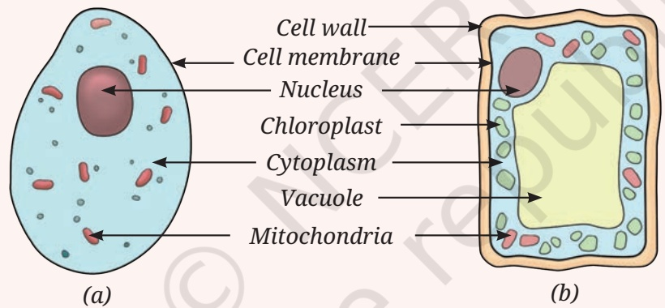
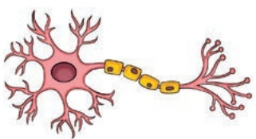

The nucleus regulates all activities that occur within the cell. It also regulates growth.

The cell wall in the plant cell provides rigidity and strength to plants. This is why all cells are arranged compactly with each other and look firm in structure.

## A step further

Cells in all parts of a plant have tiny rod-shaped structures called **plastids.** Some plastids, like **chloroplasts**, contain chlorophyll, which makes them green and helps in photosynthesis. In non-green parts, they help in the storage of substances. Plant cells also have a large, empty-looking space called a **vacuole**. This helps the plant cell store important substances, get rid of waste, and maintain the shape of the cell. This gives strength and support to the plant. In animal cells, vacuoles are usually not present, if present, they are usually small. These small vacuoles store certain substances dissolved in water (Fig. 2.5). So, a cell is not just a simple bag of liquid — it is a complex structure made up of many different parts, each with its own special function to allow the cell, and in turn the entire organism to work.

Fig. 2.5: A schematic drawing of (a) An animal cell and (b) A plant cell. (The colours are to show different parts of the cell)

We have now understood the basic structure of cell. And we now also understand that plant and animal cells differ in shape and structure.

Do different animal cells also vary in their shape and structure?

## 2.1.1 Variation in shape and structure of cells

The **muscle** cell and the **nerve** cell of a human are shown in Fig. 2.6a and (b). What are the similarities and differences you see in them?

A muscle cell (Fig. 2.6a) is shaped like a spindle, while a nerve cell (Fig. 2.6b) is very long and has branches. Similarly, some cells are round in shape, while others are long and thin. The number of cells also varies in different organisms. Why do cells look so different from each other? Does the shape and structure of a cell relate to its function?

(a) Muscle cell

(b) Nerve cell Fig. 2.6: Different types of cells in humans