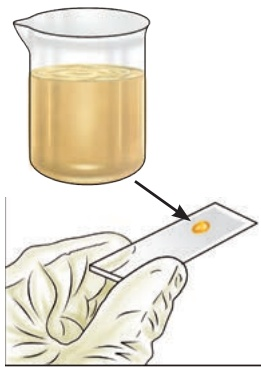
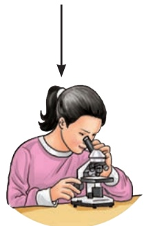
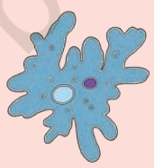
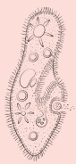
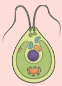

z Pour some water into the beaker and stir it with a glass rod. The liquid, which may look dirty, has very fine particles of soil, and is called soil suspension. Keep it aside for some time and let the mixture settle.

z Use a dropper and take a drop of water from the top layer. Place the drop on a microscope slide.

z Cover it gently with a coverslip and observe it under the microscope (Fig. 2.8).

Fig. 2.8: Observation of soil suspension under the microscope

You may observe small moving organisms similar to those you saw in Activity 2.4. This indicates that even **soil suspension** contains a variety of tiny creatures that cannot be seen with the unaided eye. The tiny creatures that cannot be seen with the naked eye are called microorganisms (micro means very small; organisms means living beings) or **microbes**.

## Activity 2.6: Let us study

A group of students studying in Grade 8 performed Activities 2.4 and 2.5. They also collected information from the library and internet. They recorded the data obtained after observing pond water in Table 2.1 and the data obtained after observing soil suspension in Table 2.2. They identified the microorganisms as protozoa, algae, fungi, and bacteria. You can also conduct the same activity and record if you find any of these categories of organisms.

~~Table 2.1: Organisms pr~~esent in pond water

<table><tr><td rowspan=2>S.No.</td><td rowspan=2>Microorganismsobserved</td><td></td></tr><tr><td rowspan=2>Recorded dataSingle cell, moving, irregular shape</td></tr><tr><td>1.</td><td>Amoeba(Protozoa)           </td></tr><tr><td>2.</td><td>Paramecium(Protozoa)            </td><td>Single cell, moves from one place toanother, movement takes place withthe help of specialised structures</td></tr><tr><td>3.</td><td>Algae                  </td><td>Single cell, looks green because of thepresence of green pigment, movementtakes place with the help of specialisedstructures</td></tr></table>