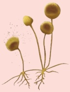
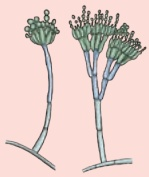
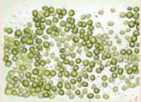
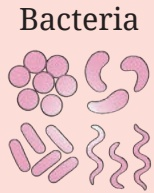
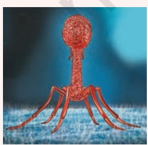

## Table 2.2: Organisms present ~~in soil suspension~~

<table><tr><td>S.No.</td><td>Diagram</td><td>Remarks</td></tr><tr><td>1.</td><td>Bread mould(Fungi)</td><td>Branched filament without chlorophyll havingsac-like structure</td></tr><tr><td>2.</td><td>Mould (Fungi)</td><td>Branched filament without chlorophyll havingbrush-like structure</td></tr><tr><td>3.</td><td>Algae</td><td>Spherical, presence of chlorophyll- agreenpigment</td></tr><tr><td>4.</td><td></td><td>Spherical, comma, spiral or rod-shaped, onelong hair-like structure and many smallhair-like projections around the cell</td></tr></table>

Did you also observe any of these microorganisms or something different? Record in your notebook and discuss in your class. In Tables 2.1 and 2.2, you have identified a variety of microorganisms. They are everywhere, and we can only see them with a microscope—a device that magnifies them 100 to 400 times. Though microorganisms are small in size, they play an important role in our lives.

## Ever heard of ...

**Viruses** are microscopic and acellular. Viruses multiply when they enter a living cell. They may infect plants, animals, or bacterial cells and may cause a disease.

