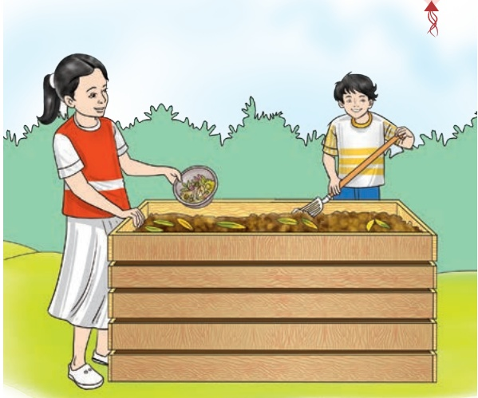

z After 2–3 weeks, observe the changes that have taken place.

z Do you observe any difference in the contents of the container?

You may find that peels of fruits and vegetables have turned into a dark-coloured material. This is **manure**, which is rich in nutrients and helps increase the fertility of the soil. But how did the peels of fruits and vegetables turn into manure?

In Activity 2.6, you saw that soil contains various kinds of microorganisms. Some of these microorganisms, like fungi and bacteria,

Fig. 2.10: Recycling of nutrients by making manure

act on the plant waste and slowly break it down into simpler, nutrient-rich manure. You may have seen gardeners in your school or in a field near your house collecting dry leaves and plant waste and putting them into pits. Do you now understand why they do this? It is to make natural manure.

## Our scientific heritage

Ancient Indian texts, particularly the Vedas, have references of the word ‘Krimi’ which means different tiny entities including ‘Drishya’ (visible) and ‘Adrishya’ (invisible). Various Vedic texts mention their beneficial and harmful effects. Atharvaveda also refers to ‘Krimi’.

If you look around carefully, you might see decaying plants and fallen leaves stored in a container or lying in the garden, disappear after some time from the surroundings. This is because microorganisms breakdown the complex substances of fallen leaves into simpler substances that are rich in nutrients — a process called **decomposition**. These nutrients go back to the soil and help plants grow better. Microorganisms also decompose bodies of dead animals. So, microbes help recycle the waste and return important nutrients to nature. Manure formation occurs at optimal temperature and appropriate moisture level.

Isn’t it interesting? By now, you must have understood that bacteria and some fungi are types of microorganisms that play an important role in our lives. And guess what, these helpful bacteria can also decompose animal wastes like dung!

From Activity 2.7, we can also infer that microorganisms not only help in plant growth, but also clean our environment by breaking down waste.