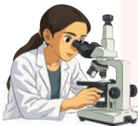
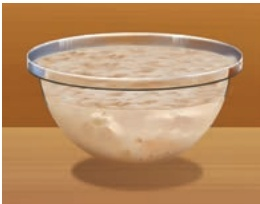
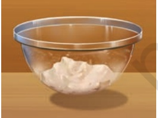

Now, think what would have happened if microorganisms did not exist on Earth?

## A step further

## Microbes as a source of biogas

Many microorganisms, like bacteria and fungi, live in an oxygenfree environment. Some of these bacteria have the ability to decompose plant and animal waste present in the environment or household wastewater. During the process, they release a mixture of gases called biogas primarily composed of carbon dioxide, and a high proportion of another gas, methane. This gas has been used as a fuel source for cooking, heating, generating electricity, and to even run vehicles.

## Be a scientist

Ananda Mohan Chakrabarty (1938–2020) was a scientist who studied bacteria. In 1971, he developed a special bacterium that could break down oil spills, helping to clean the environment. His discovery received a patent in 1980. **Patent** is a copyright given to a person so that no one else can copy, use or sell his/her invention without permission. His work showed how microorganisms could be used to solve environmental problems like pollution. He is remembered for his contributions to science and for protecting the environment using microbes. What are the other problems which you think can be solved with the help of microorganisms?

How does the diversity of microorganisms help in our kitchen?

## 2.4.2 Microorganisms and food

Let us try to understand by performing activities in the kitchen.

## (a) Dough in bowl A

(b) Dough in bowl B

Fig. 2.11: Change in the

## Activity 2.8: Let us perform

volume of flour after addition of yeast, sugar, and warm water

Take two bowls A and B.

In each, take 200 g of flour (atta or maida) and add a pinch of sugar.

z Now, in bowl A, add a small amount of yeast powder and mix it well with the flour.

z In bowl B, do not add any yeast, so that we can compare the results of the two bowls.

z Knead the flour of the two bowls with warm water to make soft dough (Fig. 2.11).