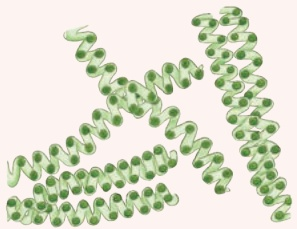
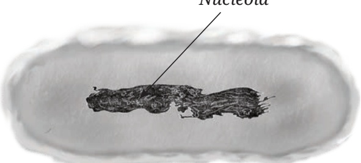

## Ever heard of ...

Spirulina, a microalga, is called a superfood because of its health benefits. Spirulina is also a good source of vitamin $\mathbf { B } _ { 1 2 ^ { \flat } }$ which is essential for our body. It is rich in protein—more than 60 per cent of its body weight—and only a small amount of fat and sugar.

Nowadays, farming of Spirulina is becoming a feasible livelihood opportunity. You can grow Spirulina easily by following these steps:

1. Set a clear glass tank in a bright place away from direct sunlight.

2. Cover the tank with a shade net, or keep the tank at a place with moderate temperature conditions.

3. Fill the tank with pond water.

4. Add living Spirulina collected from a pond.

5. Stir the growing Spirulina twice a week.

6. After 3–6 weeks, Spirulina may be harvested from the tank by filtering it through a fine cloth.

Conservation of microalgae is a good practice for ensuring food security and livelihood development.

## 2.5 Why Is Cell Considered to Be a Basic Unit of Life?

The body of all living organisms are made up of tiny building blocks called cells. A single cell contains various components that help organisms perform various functions. The bodies of all plants and animals are made up of many cells. Therefore, they are called **multicellular** (many-celled) organisms. In multicellular organisms, cells carry out specialised functions individually but also cooperate with each other to increase the chance of survival.

Some microorganisms, such as bacteria and protozoa, are made up of just one cell. These are called **unicellular** (single-celled) organisms. They carry out all the functions necessary for their survival in a single cell. Other microbes, like algae and fungi, are made up of one or more cells. For example, yeast is a unicellular fungus while mould is a multicellular fungus.

Nucleoid

Fig. 2.13: A bacterial cell showing the nucleoid region