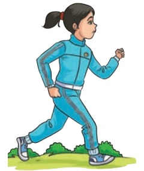
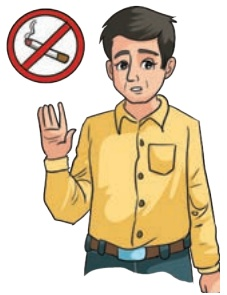
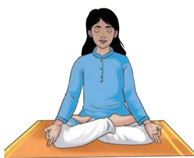
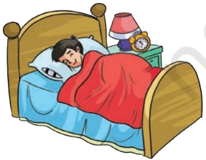

Eat a balanced diet

Stay physically active

Say ‘No’ to smoking or alcohol

sleep, spend time with family and friends, and have a positive attitude. What should we do and what should we avoid to keep ourselves healthy?

## Activity 3.2: Let us list

z List some good habits that your parents, teachers, or elders often encourage you to follow. How many of these are already a part of your daily routine? Which ones would you like to start following? Add to the list below:

{ Keep yourself clean by maintaining personal hygiene.

{ Eat a healthy and balanced diet.

{ Exercise regularly.

{ Make time to relax or meditate every day.

Now, think about habits that are not good for your health. Add more to the list below:

{ Spending too much time on mobile phones or other digital screens.

{ Eating fast food and other junk food every day.

{ Sleeping very late or not getting enough sleep.

{ Skipping meals, especially breakfast.

Taking care of our body and mind is important. Healthy habits support a healthy body as well as a healthy mind.

Discuss your findings with your friends and teacher. From the activity you participated in and the discussions, you may have realised that our health depends on many factors. These factors include our lifestyle (how we live) and our environment (our surroundings).

Manage stress

Get enough sleep

Fig. 3.2: How to be healthy

## 3.2.1 Maintain a healthy lifestyle

Eat a balanced diet with plenty of fruits, vegetables, and whole grains.

z Avoid processed, fatty, or sugary food and drinks.

Stay physically active by playing outdoors, walking, running, cycling, or exercising.

z Limit screen time and spend more time in nature.

z Get enough sleep to help your body and mind rest and recover.

z Practice yoga or simple breathing exercises like pranayama regularly.

z Say ‘NO’ to harmful substances like tobacco, alcohol, and addictive drugs (Fig. 3.2).