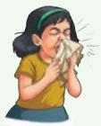
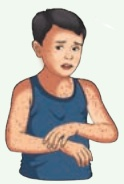

personal items of an infected person. Some of the communicable diseases spread through contaminated drinking water or food. Some pathogens are also spread by insects like mosquitos and houseflies—these insects are called **vectors** (Fig. 3.4).

By understanding how diseases spread, we can take simple steps to protect ourselves and others. Let us find out how these communicable diseases spread and how we can prevent them.

## Activity 3.4: Let us find out

Grade 8 students listed some common communicable diseases in Table 3.1 during a community campaign and a library search.

Check the information listed by referring to books, trusted websites, or asking your science teacher. Add any missing details.

Study the table and think about what simple steps can help prevent each disease.

**Table 3.1: Some common co**<s><strong>mmunicable diseases affecting</strong></s> **humans**

<table><tr><td>Diseases</td><td>Causalagent</td><td>Site ofinfection</td><td>Symptoms</td><td>Preventivemeasures</td></tr><tr><td colspan=5>Diseases spread through the air</td></tr><tr><td rowspan=3>Commoncold andinfluenza</td><td>Virus</td><td>Respiratory</td><td>Nasal congestion</td><td rowspan=3>Washing handsfrequently, notsharing personalitems, covering themouth and noseusing a mask</td></tr><tr><td rowspan=2></td><td>tract</td><td rowspan=2>and discharge,sore throat,fever, cough,body ache</td></tr><tr><td></td></tr><tr><td>ChickenpoxT</td><td>Virus</td><td>Respiratorytract, skin</td><td>Mild fever, itchyskin, rashes,blisters</td><td>Complete isolation ofthe patient, coveringthe mouth and nose,vaccination</td></tr><tr><td rowspan=2>Measles</td><td>Virus</td><td>Skin,</td><td rowspan=2>Fever, sorethroat, andreddish rasheson the neck, earsand other partsof the skin</td><td rowspan=2>Isolation of thepatient, coveringthe mouth and nose,maintaining goodhygiene, vaccination</td></tr><tr><td></td><td>respiratorytract</td></tr></table>