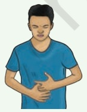

<table><tr><td>Tuberculosis (TB) </td><td>Bacteria</td><td>Lungs</td><td>Cough, fever, fatigue, loss of appetite, night sweats</td><td>Avoiding close contact with TB-infected people, covering the mouth and nose, maintaining good hygiene, getting vaccinated</td></tr><tr><td colspan="5">Diseases spread through contaminated water and food</td></tr><tr><td>Hepatitis A </td><td>Virus</td><td>Liver</td><td>Fatigue, fever, loss of appetite, nausea, vomiting, jaundice, pain in the upper right abdomen</td><td>Drinking boiled water, vaccination O C</td></tr><tr><td>Cholera </td><td>Bacteria</td><td>Intestine</td><td>Diarrhoea and dehydration</td><td>Maintain personal hygiene and good sanitary habits, consumption of properly cooked food and boiled drinking water, vaccination</td></tr><tr><td>Typhoid </td><td>Bacteria</td><td>Intestine</td><td>Headache, abdominal discomfort, fever, and diarrhoea</td><td>Maintain personal hygiene and good sanitary habits, consumption of properly cooked food and boiled drinking water, vaccination</td></tr><tr><td>Ascariasis (roundworms) </td><td>Worms</td><td>Intestine</td><td>Worms in stool, loss of appetite, poor growth, diarrhoea, weight loss, anaemia</td><td>Maintain personal hygiene and good sanitary habits, consumption of properly cooked food and boiled drinking water</td></tr></table>