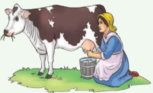
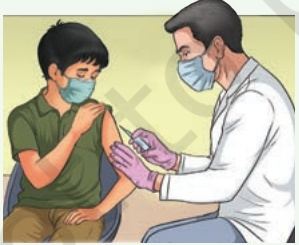
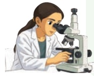
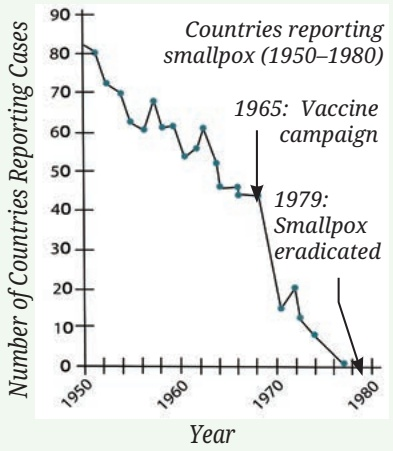

to make a harmless part of the germ, which our immune system then learns to fight.

For example, a tetanus shot, often given after an injury protects against infection by the tetanus-causing bacteria. It contains an inactivated bacterial toxin that helps the immune system develop protection without causing the disease.

Do you know when the first vaccine was discovered?

## Edward Jenner and the smallpox vaccine

Smallpox was a deadly disease that caused blisters and killed millions. A milder disease called cowpox, seen in cows, could also infect humans. In the late 1700s, English doctor Edward Jenner discovered that people who had cowpox did not get smallpox. This led to the invention of the first vaccine and helped protect people from smallpox.

## Our scientific heritage

Long before modern vaccines, India had a traditional method called variolation to protect against smallpox. It involved using material from a smallpox sore to scratch the skin and create a mild infection and build immunity. People who performed this practice were known as teekedaars.

## Think like a scientist

## Observations

Jenner observed that milkmaids who had cowpox did not catch smallpox, likely because the two viruses are related.

## Hypothesis

Content in the pus of cowpox blisters protected people from smallpox.

## Experimentation

He tested this by injecting cowpox sap into a boy, who later showed no illness when exposed

to smallpox.

## Results

He found that people who were infected with cowpox sap were now resistant to smallpox.

**Application**

Mass vaccination eventually helped eradicate smallpox worldwide.

