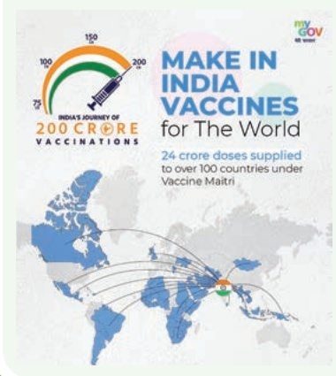
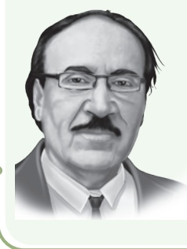

Vaccines are one of the most effective ways to protect people of all ages—from infants to the elderly—against many serious diseases. They help prevent illnesses, reduce the spread of infections, and save millions of lives every year. It is important to remember that vaccines are preventive, not curative—they can help minimise serious diseases before they happen, but do not treat them once someone is already sick. Some people may fear or doubt vaccines, but scientists and doctors carefully test them for safety. Getting vaccinated not only protects you but also the people around you.

## Ever heard of ...

## India’s Role in Vaccine Production

India is one of the world’s largest vaccine producers. It manufactures vaccines on a massive scale and supplies them to many countries. Indian vaccine companies played a key role during the COVID-19 pandemic and continue to support global health efforts.

## Be a scientist

Maharaj Kishan Bhan was a well-known Indian doctor and scientist. As Secretary of the Department of Biotechnology, he helped promote science and innovation in India. He played a key role in developing the Rotavirus vaccine, which protects children from diarrhoea. He believed in using research to create affordable healthcare and made a big difference in India’s health and biotechnology sectors.

## 3.5.1 Treatment of diseases

If our immune system fails to protect us against an infectious disease, we fall ill and need to visit a doctor. The doctor may give us medicines called **antibiotics**, which kill the bacteria that might have caused the disease. Antibiotics work only against bacterial infections because they target parts of bacterial cells that are different from human or other animal cells. They do not work against viruses or diseases caused by protozoa.