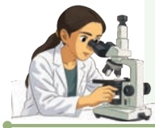
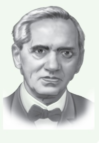
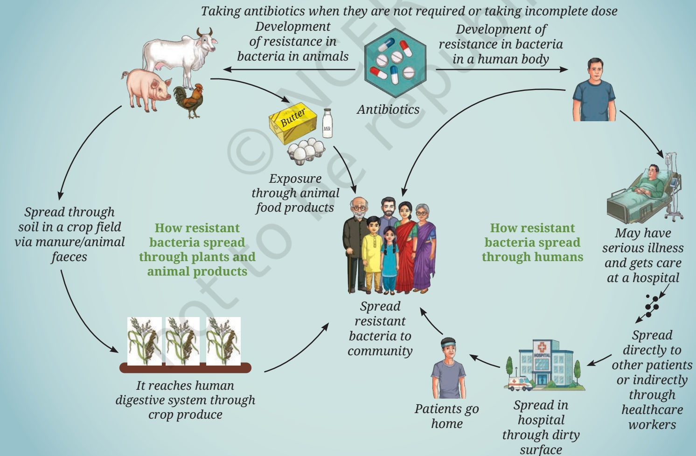

## Think like a scientist

## Discovery of the first antibiotic, Penicillin

Penicillin was discovered in 1928 by Alexander Fleming, a bacteriologist from London. While studying harmful bacteria, he noticed that a mould on a discarded petri dish stopped the bacteria from growing. He realized the mould released a substance that killed the bacteria. This chance discovery led to the discovery of penicillin, the first antibiotic used to treat bacterial infections.

Though antibiotics are effective in protecting us against bacterial infections and have saved millions of lives since their discovery, their indiscriminate use has led to a decline in their effectiveness (Fig. 3.5a). Nowadays, there are news headlines about **antibiotic resistance**, a phenomenon where bacteria that were earlier killed by a given antibiotic are found to survive and multiply despite treatment with that antibiotic. This makes

## HOW ANTIBIOTIC RESISTANCE SPREADS IN THE COMMUNITY?

Fig. 3.5 (a): Spread of antibiotic-resistant bacteria in community