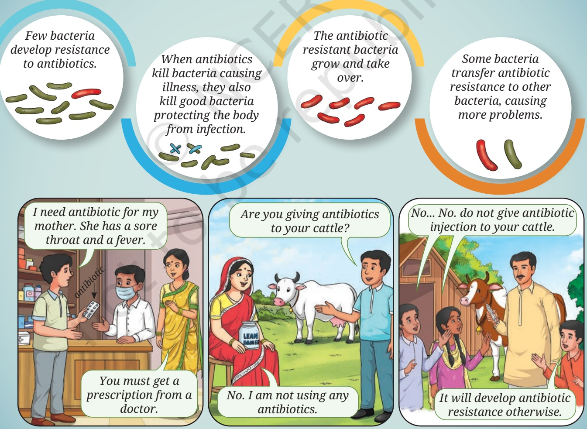

common infections harder to treat and increases the risk of c<u>omplications, prolonged illness, and even death.</u>

## Activity 3.7: Let us infer

z Study the infographic given in Fig. 3.5b. How do you think the antibiotic resistance has been developed in bacterial pathogens? What precautions may be taken to reduce antibiotic resistance?

To tackle the problem of antibiotic resistance, we must use antibiotics wisely—only when prescribed by a doctor, in the correct dose, and for the right duration. Avoiding unnecessary use helps prevent the rise of resistant bacteria and keeps antibiotics effective for future generations.

Traditional medicine systems like Ayurveda, Siddha, and Unani have been used in India for many years to manage common health problems. They use natural substances like herbs, oils,

HOW BACTERIA BECAME RESISTANT TO ANTIBIOTICS?

Fig. 3.5 (b): Development of antibiotic-resistant bacteria and preventive measures